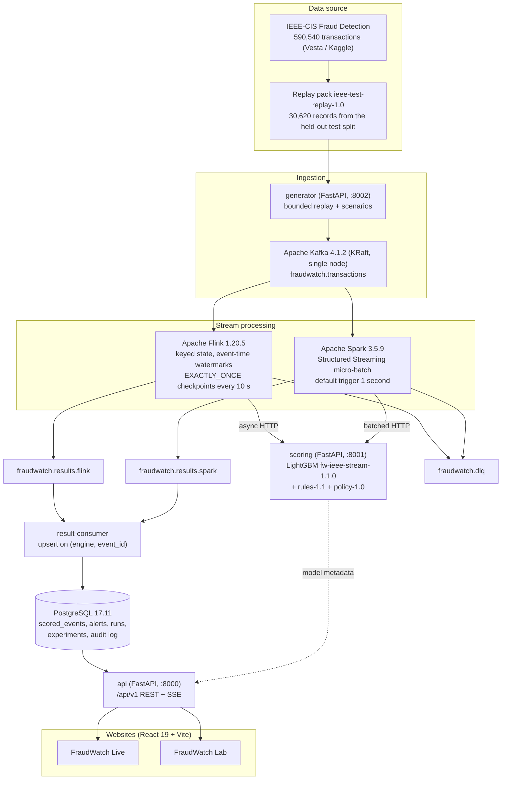
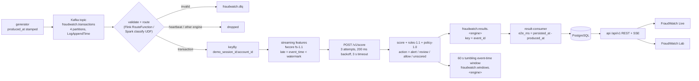
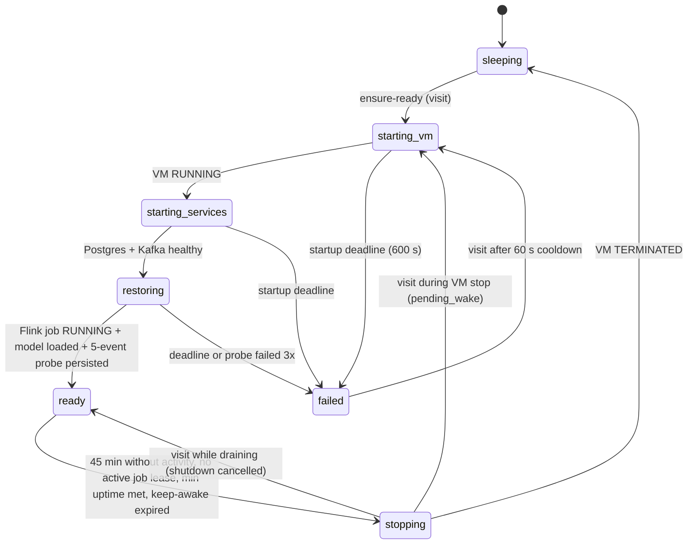
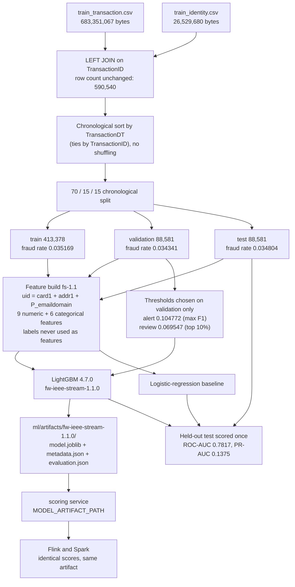

# FraudWatch

**Real-time fraud detection on a real Apache streaming stack, with an honest academic comparison of Apache Flink (true streaming) against Apache Spark Structured Streaming (micro-batch).** Transactions replayed from the IEEE-CIS Fraud Detection dataset are published to Kafka, enriched with per-account streaming features by Flink and/or Spark, scored by a LightGBM model behind an HTTP scoring service, persisted to PostgreSQL, and streamed to two React websites — **FraudWatch Live** (operations view) and **FraudWatch Lab** (CA1/CA2 evidence view). The whole backend runs on one Compute Engine VM that wakes on a visit and stops itself after 45 idle minutes, so the demo stays inside Google Cloud Free Trial credit.

[](https://flink.apache.org/)
[](https://spark.apache.org/)
[](https://kafka.apache.org/)
[](https://www.postgresql.org/)
[](https://www.python.org/)
[](https://lightgbm.readthedocs.io/)
[](https://react.dev/)
[](https://www.typescriptlang.org/)
[](https://vite.dev/)
[](https://docs.docker.com/compose/)
[](https://cloud.google.com/run)

> Versions in the badges are the pinned versions in this repository: `streaming/flink/Dockerfile` and `streaming/flink/pom.xml` (Flink), `streaming/spark/Dockerfile` (Spark), `infra/compose/compose.yaml` (Kafka, PostgreSQL), `services/*/Dockerfile` (Python), `ml/artifacts/fw-ieee-stream-1.1.0/metadata.json` (LightGBM), `package.json` (React, TypeScript, Vite).
>
> There is no `.github/workflows` directory in this repository, so there is no CI badge. There is no `LICENSE` file either — see [License and academic integrity](#license-and-academic-integrity).

---

## Deployed endpoints

| What | URL | Verified state |
|---|---|---|
| Lifecycle controller (`/health`, `/lifecycle/status`, `/api/v1/*` proxy) | <https://fraudwatch-control-997216389793.asia-south1.run.app> | **Live.** `GET /health` returned `200 {"status":"ok"}` and `GET /lifecycle/status` returned a real state document when checked while writing this README. |
| FraudWatch Live | `https://fraudwatch-live-997216389793.asia-south1.run.app` | **Pending deployment verification.** This is the URL shape `infra/gcp/05-deploy-sites.sh` produces; the URL returned HTTP 404 when checked, so the service is not deployed (or not yet deployed under this name). |
| FraudWatch Lab | `https://fraudwatch-lab-997216389793.asia-south1.run.app` | **Pending deployment verification** (same check, HTTP 404). |

Useful controller calls (no auth required, no secrets returned):

```bash
curl -s https://fraudwatch-control-997216389793.asia-south1.run.app/health
curl -s https://fraudwatch-control-997216389793.asia-south1.run.app/lifecycle/status
curl -s https://fraudwatch-control-997216389793.asia-south1.run.app/lifecycle/history
```

`/lifecycle/status` reports the pipeline state machine (`sleeping`, `starting_vm`, `starting_services`, `restoring`, `ready`, `stopping`, `failed`). A `503` with `{"error":{"code":"pipeline_<state>", ...}}` from a proxied API call means the backend VM is still waking — that is expected behaviour, not an outage.

---

## System architecture



`services/ops-agent/` exists as an empty directory: the experiment runner that `api` would call at `OPS_AGENT_URL` is **not implemented**. See [Limitations](#limitations-and-honesty).

---

## Event flow



Facts behind this diagram, all read from the code:

- Watermarks: bounded out-of-orderness **5 s** with **30 s** idleness in Flink (`FraudWatchJob.java`); `withWatermark("event_ts", "5 seconds")` in Spark (`streaming/spark/job.py`).
- Windows: 60 s tumbling event-time windows per `demo_session_id`, `allowedLateness(0)` in Flink; a 60 s tumbling window in append mode in Spark after `dropDuplicatesWithinWatermark(event_id)`.
- `e2e_ms` is computed by `services/result-consumer/app/main.py` as `persisted_at - produced_at` — a full producer-to-database latency, not an engine-internal latency.
- Kafka result and DLQ sinks use `DeliveryGuarantee.AT_LEAST_ONCE` with idempotent producers; duplicates are collapsed by the `(engine, event_id)` upsert in PostgreSQL.

---

## Cloud wake / idle lifecycle

This mirrors the state machine in [`docs/gcp-deployment.md`](docs/gcp-deployment.md), which is the authoritative version.



Only `POST /lifecycle/ensure-ready`, `POST /lifecycle/activity` and proxied `POST`/`PATCH` API calls count as activity. Passive `GET` polling does not keep the VM awake. Guards in `services/controller/app.py`: 10 wakes per 10 min per hashed client IP, `PIPELINE_MAX_WAKES_PER_DAY=24`, `PIPELINE_MAX_UPTIME_HOURS_PER_DAY=12`, 60 s cooldown after a failed start, operator keep-awake capped at 180 min.

---

## Machine learning pipeline



Java/Python feature parity is enforced at build time: `streaming/flink/Dockerfile` runs `FeatureParityTest` against `tests/streaming/fixtures` and the image build fails if the Java features diverge from `fwcore`. The offline parity check recorded in `ml/data/processed/prepare_manifest.json` covers 405 pseudo-accounts and 34,801 events with a maximum relative difference of `3.67e-13`.

---

## Repository layout

```mermaid
flowchart TD
  ROOT["FraudWatch/"]

  ROOT --> APPS["apps/"]
  APPS --> APPL["live/ — operations site (React 19 + Vite, dev :5173)"]
  APPS --> APPB["lab/ — CA1/CA2 evidence site (dev :5174)"]

  ROOT --> PKG["packages/"]
  PKG --> PKC["contracts/ — TypeScript API types, client, SSE hooks"]
  PKG --> PKU["ui/ — shared components, pipeline + landing 3D scenes, charts"]
  PKG --> PKF["fwcore/ — Python features, schema, rules, policy, replay, presets"]

  ROOT --> SVC["services/"]
  SVC --> S1["api/ — FastAPI /api/v1 + SSE (:8000)"]
  SVC --> S2["scoring/ — LightGBM scoring (:8001)"]
  SVC --> S3["generator/ — replay + scenario producer (:8002)"]
  SVC --> S4["result-consumer/ — Kafka to PostgreSQL sink"]
  SVC --> S5["controller/ — Cloud Run lifecycle + API proxy"]
  SVC --> S6["common/ — settings, db pool, migrations, logging"]
  SVC --> S7["ops-agent/ — EMPTY: experiment runner not implemented"]

  ROOT --> STR["streaming/"]
  STR --> STF["flink/ — Java 17 job, pom.xml, submit.sh, parity test"]
  STR --> STS["spark/ — PySpark job.py, run.sh"]

  ROOT --> INF["infra/"]
  INF --> INC["compose/ — compose.yaml + compose.streaming.yaml"]
  INF --> ING["gcp/ — 00..05 deploy scripts, vm/, web/"]

  ROOT --> MLD["ml/"]
  MLD --> MLT["training/ — ieee_data, train_stream_model, train_reference_model, build_replay_pack"]
  MLD --> MLE["evaluation/ — metrics"]
  MLD --> MLA["artifacts/ — fw-ieee-stream-1.1.0, replay pack (gitignored)"]

  ROOT --> TST["tests/ — e2e (Playwright), integration, streaming parity"]
  ROOT --> DOC["docs/ — contracts, gcp-deployment, local-setup, apache-stack, model-card, benchmark-methodology, demo-script, status-checklist"]
```



---

## Dataset

**IEEE-CIS Fraud Detection**, contributed by **Vesta Corporation** to the Kaggle competition [`ieee-fraud-detection`](https://www.kaggle.com/competitions/ieee-fraud-detection). Every figure below comes from `ml/data/processed/prepare_manifest.json`, which is written by `ml/training/ieee_data.py` from the actual CSV files.

| Property | Value |
|---|---|
| Rows (after `train_transaction LEFT JOIN train_identity` on `TransactionID`) | **590,540** (1:0..1 join; row count unchanged) |
| Transactions with an identity row | 144,233 |
| Overall fraud rate (`isFraud`) | **0.03499000914417313** (≈ 3.50%) |
| Split | chronological by `TransactionDT`, ties by `TransactionID`, **no shuffling**, fractions 0.70 / 0.15 / 0.15 |
| Split counts | train 413,378 · validation 88,581 · test 88,581 |
| Split fraud rates | 0.035169 · 0.034341 · 0.034804 |
| Split boundaries (source event time, seconds) | validation starts at 10,438,003 · test starts at 13,151,880 |
| Pseudo-account key | **`uid = card1 + addr1 + P_emaildomain`** — the dataset has no account identifier |
| Label field | `isFraud` from `train_transaction.csv`, never used as a feature |
| Feature spec | `fs-1.1` |
| `train_transaction.csv` | 683,351,067 bytes, sha256 `3a5c83ab…83d642` |
| `train_identity.csv` | 26,529,680 bytes, sha256 `b63c725d…03c37c` |

### Amounts have no currency

`TransactionAmt` is carried through the pipeline **unchanged, in the dataset's own unit**. The manifest, the model metadata and `fwcore/rules.py` all record the unit as *"source unit (IEEE-CIS TransactionAmt, unit unspecified in the data files; no conversion)"*. There is **no currency symbol, no INR conversion and no exchange rate** anywhere in the scoring path. Rule thresholds (for example R2's "at least 60", R3's "under 2.5 … at least 25") are in those same source units. Any UI label that implies a currency is a bug.

### Replay pack

`ml/artifacts/replay/ieee-test-replay-1.0/` (built by `ml/training/build_replay_pack.py`, **gitignored** because it is row-level Kaggle-derived data) contains 30,620 records drawn only from the held-out test split: 30,000 contiguous records, 300 selected fraud and 300 selected ordinary examples, and 374 records across 40 pseudo-account bursts. Labels live in a separate `labels.json` used only on the evaluation path — they are never placed in Kafka events or scoring requests.

---

## Model

Main model **`fw-ieee-stream-1.1.0`** (LightGBM 4.7.0), plus a logistic-regression baseline. All numbers below are read from `ml/artifacts/fw-ieee-stream-1.1.0/evaluation.json`; the held-out test split was scored once, with thresholds fixed on validation.

| Metric (held-out test, n = 88,581) | LightGBM | Logistic regression |
|---|---|---|
| ROC-AUC | **0.7817** | 0.7603 |
| PR-AUC | **0.1375** | 0.0961 |
| Precision @ alert threshold | 0.1508 | 0.1420 |
| Recall @ alert threshold | 0.3675 | 0.2517 |
| F1 @ alert threshold | 0.2138 | 0.1816 |
| Flagged rate | 8.48% | 6.17% |

Thresholds: `alert = 0.10477242918040724` (max F1 on validation), `review = 0.06954678512105691` (top 10% of validation scores). **The output is a model score in [0, 1], not a calibrated probability** — that is the exact wording stored in `metadata.json`. Full details, limitations and intended use: [`docs/model-card.md`](docs/model-card.md).

---

## Quickstart (local)

### Prerequisites

- Docker Desktop with Compose V2
- Node.js ≥ 22 (`package.json` `engines`) and npm
- Python 3.12 if you want to run the ML or integration scripts outside containers
- Java 17 + Maven only if you build the Flink jar outside Docker (the Docker build does it for you)

### 1. Create `.env`

```bash
cp .env.example .env
# then fill in POSTGRES_PASSWORD, INTERNAL_API_TOKEN, SESSION_SIGNING_SECRET,
# OPERATOR_AUTH_SECRET and CLIENT_HASH_SALT with your own random values
```

Compose fails fast if `POSTGRES_PASSWORD`, `INTERNAL_API_TOKEN`, `SESSION_SIGNING_SECRET`, `OPERATOR_AUTH_SECRET` or `CLIENT_HASH_SALT` is missing.

### 2. Bring the stack up

Run this from the repository root — `--env-file` is required because Compose otherwise looks for a `.env` next to the compose file:

```bash
docker compose --env-file .env -p fraudwatch \
  -f infra/compose/compose.yaml \
  -f infra/compose/compose.streaming.yaml up -d
```

Spark is behind a Compose profile and is **not** started by that command. Start it only when you need the comparison:

```bash
docker compose --env-file .env -p fraudwatch \
  -f infra/compose/compose.yaml -f infra/compose/compose.streaming.yaml \
  --profile spark up -d spark
```

### 3. Run the websites

`.npmrc` in this repository sets `workspaces=false` (the repo lives on an exFAT volume that cannot hold npm's workspace symlinks). **`npm run -w <pkg> …` does not work here.** Only the root scripts do:

```bash
npm install          # installs the pinned root dependency set
npm run dev:live     # http://localhost:5173
npm run dev:lab      # http://localhost:5174
npm run build        # build:live + build:lab
npm run build:live   # or npm run build:lab
npm run typecheck    # contracts, ui, live, lab, tests/e2e
npm run test         # vitest over packages/contracts and packages/ui
npm run test:e2e     # Playwright against the production preview builds
```

Internal packages resolve through Vite aliases and TypeScript paths rather than through `node_modules` symlinks.

### Local ports

| Service | Host port | Notes |
|---|---|---|
| api | `${API_HOST_PORT:-8000}` bound to `${API_BIND:-127.0.0.1}` | `/api/v1`, SSE |
| Kafka (HOST listener) | `127.0.0.1:29092` | local tests only |
| PostgreSQL | `127.0.0.1:${POSTGRES_HOST_PORT:-15432}` | local tests only |
| Flink Web UI / REST | `127.0.0.1:${FLINK_UI_HOST_PORT:-8081}` | job submission through the UI is disabled |
| Spark UI | `127.0.0.1:${SPARK_UI_HOST_PORT:-4040}` | only with the `spark` profile |
| scoring, generator, result-consumer | not published | reachable inside the Compose network only |

Full walkthrough and troubleshooting: [`docs/local-setup.md`](docs/local-setup.md). Streaming-specific configuration: [`docs/apache-stack.md`](docs/apache-stack.md).

---

## Cloud deployment

Everything runs in Google Cloud project `fraudwatch-508912`, region `asia-south1`:

- **Cloud Run** (min instances 0): `fraudwatch-live`, `fraudwatch-lab` (static nginx bundles) and `fraudwatch-control` (lifecycle controller + `/api/v1` proxy, including SSE).
- **Compute Engine** `fraudwatch-pipeline` (`e2-standard-4`, 60 GB pd-balanced, zone `asia-south1-a`): Kafka, Flink, Spark on demand, scoring, generator, result-consumer, API and PostgreSQL. **No public application port** — a firewall rule allows only `tcp:8000` from the Cloud Run egress subnet.
- **Firestore** holds lifecycle state, the wake lock, activity, rate limits and history; **Cloud Tasks** carries the step and idle timers with OIDC tokens the controller verifies.

Deploy scripts run in order: `infra/gcp/00-verify-billing.sh`, `01-bootstrap.sh`, `02-create-vm.sh`, `05-deploy-sites.sh`, `03-sync-and-build.sh`, `04-deploy-controller.sh`. Details, service-account scopes, rollback and cleanup: [`docs/gcp-deployment.md`](docs/gcp-deployment.md).

### Wake on visit, stop when idle

A visit to either site calls `POST /lifecycle/ensure-ready`; the controller starts the VM, waits for Postgres and Kafka, waits for the Flink job to reach `RUNNING` with the model loaded, runs a 5-event probe, then reports `ready`. After **45 minutes** without meaningful activity (and with no active job lease, minimum uptime met and no keep-awake), it drains running jobs and stops the VM. On the next boot the Flink submitter restores from the newest complete retained checkpoint.

### Cost posture: zero out-of-pocket

The project is linked to a **Free Trial** billing account. Everything above consumes **trial credit, which is not money charged**. The billing account must never be upgraded — the ₹0 out-of-pocket requirement depends on staying on the trial. The cost table in `docs/gcp-deployment.md` is built from **list prices** and is labelled there as **estimates**; check Billing → Reports for actual consumption. A stopped VM is not free: the persistent disk, stored images and secrets keep consuming a little credit. The daily wake cap (24) and uptime cap (12 h) bound the worst case.

---

## The two websites

### FraudWatch Live (`apps/live`)

Operations view of a running pipeline. Routes present in `apps/live/src/App.tsx`: a landing page, `/console` (overview), `/pipeline`, `/alerts`, `/scenario` and `/tx/:eventId` (inspector). It shows live scored transactions over SSE, observed latency percentiles, the alert queue, a pipeline view including 3D scenes from `packages/ui/src/pipeline/`, and bounded scenario injection (replay, delayed arrival, duplicate delivery, pseudo-account bursts) from `fwcore/presets.py`.

### FraudWatch Lab (`apps/lab`)

Academic evidence view. Routes in `apps/lab/src/App.tsx`: home, `/ca1`, `/ca2`, `/experiments`, `/architecture`, `/evidence`, plus a redirect from the retired `/viva` route to home. CA1 covers the dataset, the feature spec and model evaluation; CA2 is the Flink-vs-Spark comparison workspace. **The experiment runner behind `/experiments` is not implemented** (see below), so experiments submitted there stay `queued`.

Both sites share server-owned state through `demo_session_id` and `run_id` and are served the same `config.js` at container start, so they point at one backend and one database.

---

## Configuration

Copy `.env.example` to `.env`. The full annotated list is in that file; the most important entries:

| Variable | Default | Purpose |
|---|---|---|
| `POSTGRES_USER` / `POSTGRES_DB` | `fraudwatch` / `fraudwatch` | database identity |
| `POSTGRES_PASSWORD` | *(required)* | Compose refuses to start without it |
| `INTERNAL_API_TOKEN` | *(required)* | guards `/internal/*` between controller, API and ops paths |
| `SESSION_SIGNING_SECRET` | *(required)* | signs visitor session tokens |
| `OPERATOR_AUTH_SECRET` | *(required)* | signs operator tokens |
| `CLIENT_HASH_SALT` | *(required)* | salts hashed client IPs for rate limiting |
| `OPERATOR_PASSPHRASE_HASH` | empty | generated by `scripts/hash_passphrase.py`; empty disables passphrase login |
| `KAFKA_TRANSACTIONS_TOPIC` | `fraudwatch.transactions` | input topic |
| `KAFKA_FLINK_RESULTS_TOPIC` / `KAFKA_SPARK_RESULTS_TOPIC` | `fraudwatch.results.flink` / `.spark` | per-engine result topics |
| `MODEL_ARTIFACT_PATH` / `MODEL_VERSION` | `/models/fw-ieee-stream-1.1.0` | model artifact mounted into `scoring` |
| `DEMO_MAX_EVENTS_PER_SESSION` / `DEMO_MAX_EVENTS_PER_SECOND` | `5000` / `50` | public demo caps |
| `EXPERIMENT_MAX_EVENTS_PER_SECOND` | `1000` | operator experiment cap |
| `FLINK_PARALLELISM` / `FLINK_GROUP_ID` | `2` / `fw-flink-v1` | Flink job shape and consumer group |
| `SPARK_TRIGGER_INTERVAL` | `1 second` | Spark micro-batch trigger |
| `AI_PROVIDER` / `AI_FALLBACK_ENABLED` | `groq` / `true` | assistant provider order: Groq → Gemini → OpenAI, then a deterministic fallback |
| `GROQ_API_KEY` / `GEMINI_API_KEY` / `OPENAI_API_KEY` | empty | optional; without them the assistant answers deterministically |
| `AUTO_WAKE_ENABLED` | `true` | cloud controller only |
| `PIPELINE_IDLE_TIMEOUT_MINUTES` | `45` | cloud controller only |

---

## Testing

```bash
npm run typecheck                                 # TypeScript across packages, apps and the e2e suite
npm run test                                      # vitest unit tests (contracts, ui)
npm run test:e2e:install && npm run test:e2e      # Playwright, both sites, backend optional
pytest tests/integration/smoke_scoring.py         # scoring service smoke test
pytest tests/streaming/parity_integration.py      # Java/Python feature parity
```

The Playwright suite runs against `vite preview` production builds, so it exercises the same bundle deployed to Cloud Run; specs tagged `@backend` are skipped unless `FRAUDWATCH_E2E_API` is set. The Flink image build also runs `FeatureParityTest` and fails if Java features diverge from `fwcore`.

---

## Limitations and honesty

- **The experiment runner is not implemented.** `services/ops-agent/app/` is an empty directory. `POST /api/v1/experiments` inserts a `queued` row, and nothing advances it; `POST /api/v1/ops/spark/start|stop` would fail to reach `OPS_AGENT_URL`. Consequently **no Flink-vs-Spark benchmark numbers exist in this repository** — the methodology is documented in [`docs/benchmark-methodology.md`](docs/benchmark-methodology.md), but the measurements are **_not measured yet_**.
- **No throughput or latency figures are published here.** `e2e_ms` percentiles are computed live from PostgreSQL by the API; nothing is committed, so this README quotes none.
- **Model quality is modest and stated as measured.** PR-AUC 0.1375 on a 3.48%-positive test split, precision 0.151 at the alert threshold — that is a real, unflattering number, not a rounded-up one. The deployable feature set (`fs-1.1`) deliberately excludes Vesta's engineered C/D/M/V aggregates because a streaming engine cannot recompute them from raw events; `ml/training/train_reference_model.py` exists to quantify that gap but its output artifact is not committed, so the gap is **_not measured yet_** here.
- **Scores are not calibrated probabilities.** Brier and ECE are recorded in `evaluation.json`, but the artifact metadata explicitly declines to call the score a probability.
- **`alert` means "flagged for priority review"** — never "confirmed fraud" and never "payment blocked" (`fwcore/policy.py`).
- **Amounts have no currency.** See the dataset section.
- **The two site URLs above are unverified**; only the controller responded when checked.
- **Typecheck, build and the test suites were not run while writing this documentation**, so their current pass/fail state is unverified here.
- `AUTO_DEMO_ENABLED` and `AUTO_DEMO_MAX_EVENTS` appear in `docs/gcp-deployment.md` and in `.env.example` but are **not referenced by any code in this repository** yet.

A per-item status table is in [`docs/status-checklist.md`](docs/status-checklist.md).

---

## Documentation

| Document | Contents |
|---|---|
| [`docs/local-setup.md`](docs/local-setup.md) | prerequisites, `.env`, compose up/down, ports, first-run checks, troubleshooting |
| [`docs/apache-stack.md`](docs/apache-stack.md) | Kafka KRaft, Flink checkpointing and restore, Spark profile, watermarks and late events |
| [`docs/gcp-deployment.md`](docs/gcp-deployment.md) | wake-on-visit, idle shutdown, IAM, cost model, rollback, cleanup |
| [`docs/model-card.md`](docs/model-card.md) | task, data, split, features, metrics, thresholds, limitations, intended use |
| [`docs/benchmark-methodology.md`](docs/benchmark-methodology.md) | how a fair Flink-vs-Spark comparison is defined here, and what it does not prove |
| [`docs/contracts.md`](docs/contracts.md) | Kafka payloads, scoring API, `/api/v1` REST + SSE surface |
| [`docs/demo-script.md`](docs/demo-script.md) | 5–7 minute walkthrough of the deployed system |
| [`docs/status-checklist.md`](docs/status-checklist.md) | per-item done / partial / not started, conservatively marked |

---

## Project and team

Academic project for **Big Data Analytics & Distributed Systems**, Group 4.
CA1: real-time fraud detection with big data analytics and machine learning.
CA2 (beyond syllabus): Apache Flink true stream processing versus Apache Spark Structured Streaming micro-batch.

- Hardik Hinduja ([@Hardik182005](https://github.com/Hardik182005)) — architecture, web applications, GCP deployment
- Avinash Gehi ([@Avi36005](https://github.com/Avi36005)) — streaming pipelines (Flink/Spark), ML engine, integration
- Siddharth Dey — data analysis, benchmarking, evaluation
- Sahil Deshmukh — infrastructure, cloud setup, security operations

## License and academic integrity

There is **no `LICENSE` file** in this repository, so no open-source licence is granted. The project is built for academic evaluation. Use of the IEEE-CIS data is governed by the Kaggle `ieee-fraud-detection` competition rules and Vesta Corporation's terms; row-level data and the derived replay pack are gitignored and are not bundled into either frontend.
