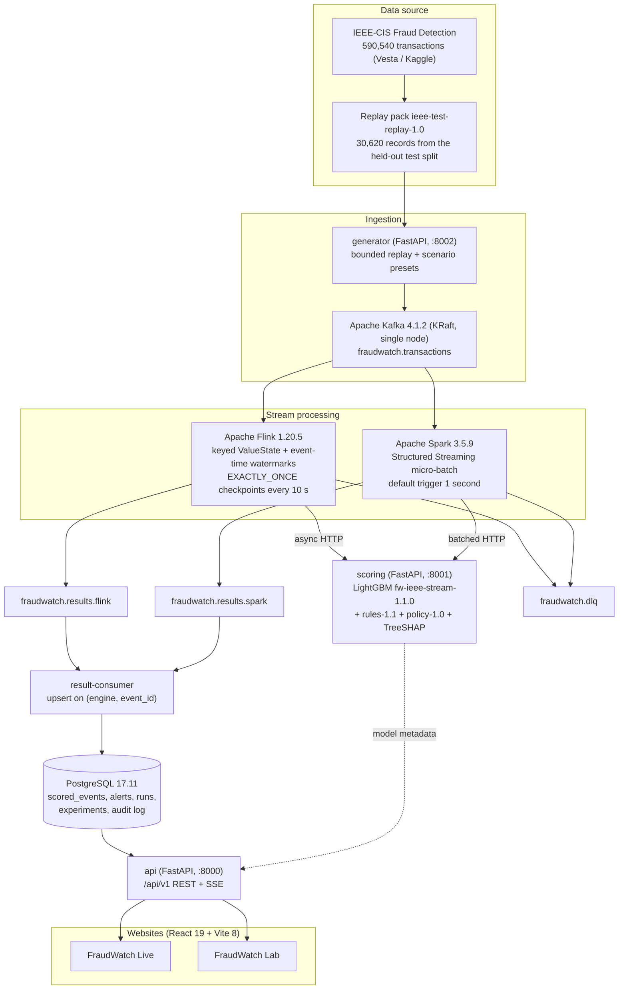
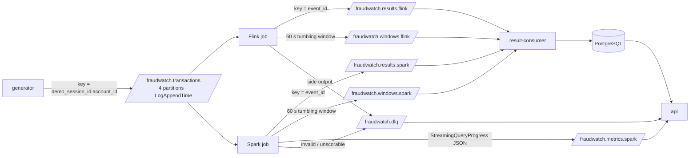
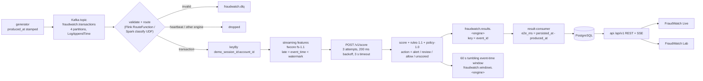
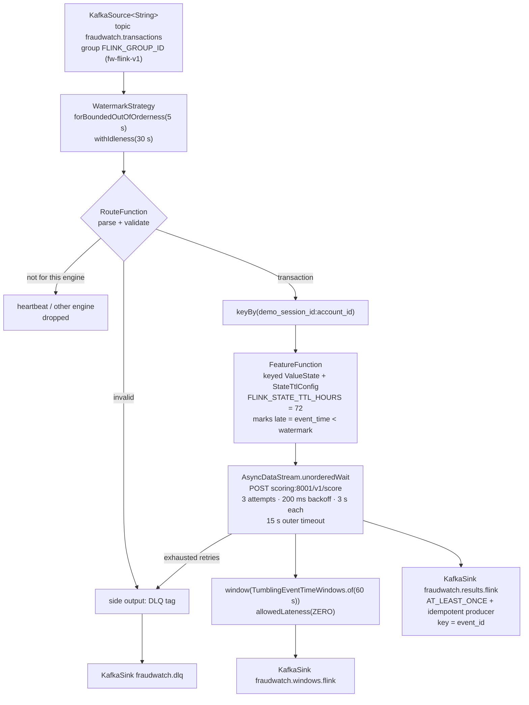
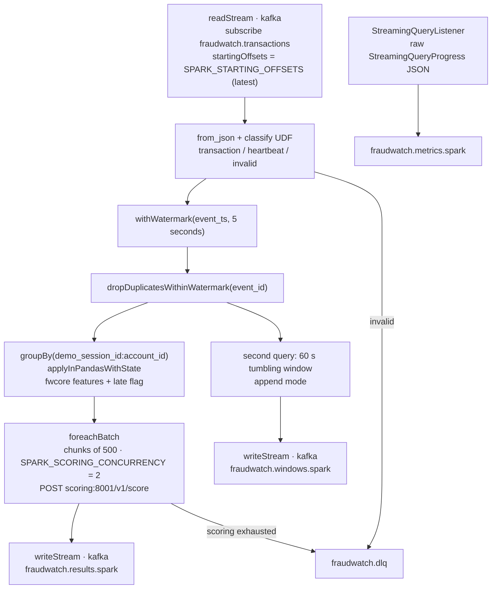
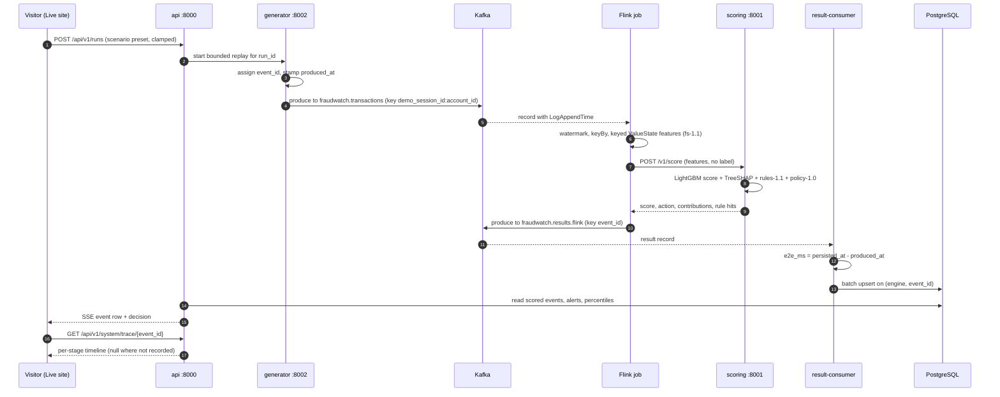
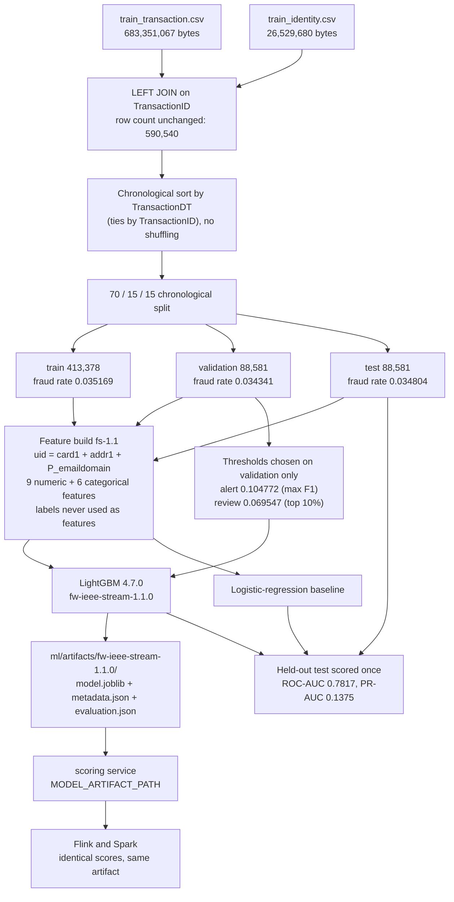
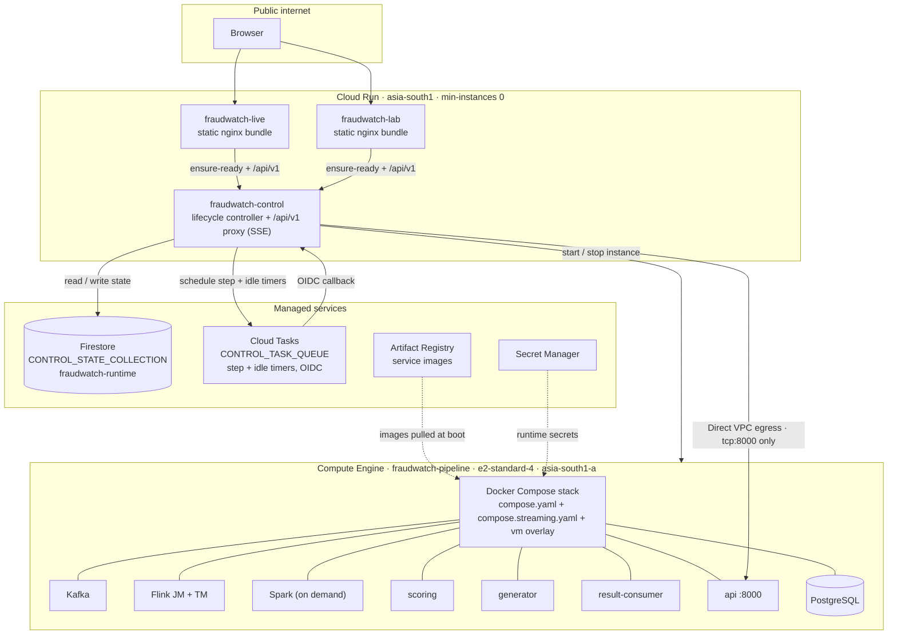
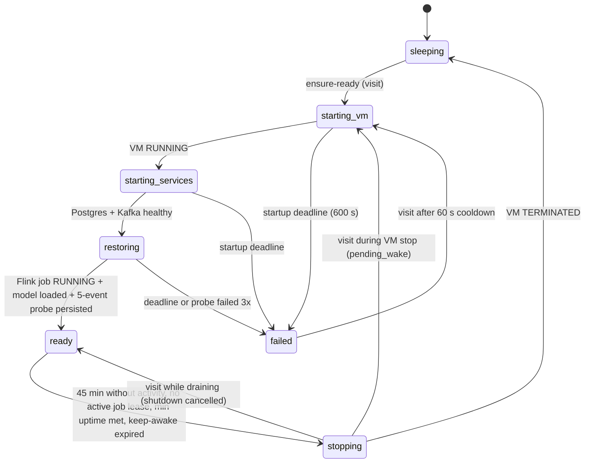

<div align="center">

# FraudWatch

**Real-time fraud detection on a real Apache streaming stack, with an honest academic comparison of Apache Flink (true streaming) against Apache Spark Structured Streaming (micro-batch).**

Transactions replayed from the IEEE-CIS Fraud Detection dataset are published to Apache Kafka, enriched with per-account streaming features by Flink and/or Spark, scored by a LightGBM model behind one shared HTTP scoring service, persisted to PostgreSQL, and streamed to two React websites — **FraudWatch Live** (operations console) and **FraudWatch Lab** (CA1/CA2 evidence). The whole backend runs on a single Compute Engine VM that wakes on a visit and stops itself after 45 idle minutes, so the deployment stays inside Google Cloud Free Trial credit.

<!-- platform / runtime -->
[](https://flink.apache.org/)
[](https://spark.apache.org/)
[](https://kafka.apache.org/)
[](https://www.postgresql.org/)
[](https://openjdk.org/projects/jdk/17/)
[](https://www.python.org/)

<!-- machine learning -->
[](https://lightgbm.readthedocs.io/)
[](https://scikit-learn.org/)
[](https://pandas.pydata.org/)
[](https://numpy.org/)
[](https://www.kaggle.com/competitions/ieee-fraud-detection)

<!-- services -->
[](https://fastapi.tiangolo.com/)
[](https://www.uvicorn.org/)
[](https://docs.pydantic.dev/)
[](https://www.psycopg.org/)

<!-- frontend -->
[](https://react.dev/)
[](https://www.typescriptlang.org/)
[](https://vite.dev/)
[](https://threejs.org/)
[](https://nodejs.org/)

<!-- tooling / infrastructure -->
[](https://docs.docker.com/compose/)
[](https://cloud.google.com/run)
[](https://vitest.dev/)
[](https://playwright.dev/)
[](#testing)
[](#license-and-academic-integrity)
[](docs/measured-results.md)
[](docs/benchmark-methodology.md)
[](docs/measured-results.md)

</div>

> **About these badges.** Every version is the version *pinned in this repository*, not a "latest"
> claim: `streaming/flink/Dockerfile` and `streaming/flink/pom.xml` (Flink, Java),
> `streaming/spark/Dockerfile` (Spark), `infra/compose/compose.yaml` (Kafka, PostgreSQL),
> `services/*/Dockerfile` and `services/*/requirements.txt` (Python, FastAPI, Uvicorn, Pydantic,
> psycopg, LightGBM, scikit-learn, pandas, NumPy), `ml/artifacts/fw-ieee-stream-1.1.0/metadata.json`
> (model), `package.json` (React, TypeScript, Vite, three, Vitest, Playwright, Node engine).
>
> **There is deliberately no CI status badge.** This repository has no `.github/workflows/` directory,
> so there is no pipeline whose result could be reported, and inventing a green badge would be a lie.
> The two grey badges state absences truthfully — no CI, and no `LICENSE` file. The red badge is not a
> build failure; it is the honest state of the engine comparison, see
> [Benchmarking](#benchmarking-and-why-there-are-no-numbers).

---

## Table of contents

- [Deployed endpoints](#deployed-endpoints)
- [At a glance](#at-a-glance)
- [System architecture](#system-architecture)
- [Kafka topics and dataflow](#kafka-topics-and-dataflow)
- [Event flow](#event-flow)
- [The Flink job DAG](#the-flink-job-dag)
- [The Spark micro-batch comparison path](#the-spark-micro-batch-comparison-path)
- [One transaction, end to end](#one-transaction-end-to-end)
- [Machine learning pipeline](#machine-learning-pipeline)
- [Cloud deployment topology](#cloud-deployment-topology)
- [Cloud wake and idle lifecycle](#cloud-wake-and-idle-lifecycle)
- [Services and ports](#services-and-ports)
- [Repository layout](#repository-layout)
- [Dataset](#dataset)
- [Model](#model)
- [Quickstart (local)](#quickstart-local)
- [Configuration](#configuration)
- [The two websites and their routes](#the-two-websites-and-their-routes)
- [API surface](#api-surface)
- [Testing](#testing)
- [Measured evidence: Flink fault tolerance](#measured-evidence-flink-fault-tolerance)
- [Figures](#figures)
- [Benchmarking and why there are no numbers](#benchmarking-and-why-there-are-no-numbers)
- [Troubleshooting](#troubleshooting)
- [Security notes](#security-notes)
- [Cost posture: zero out-of-pocket](#cost-posture-zero-out-of-pocket)
- [Limitations and honesty](#limitations-and-honesty)
- [Documentation](#documentation)
- [Project and team](#project-and-team)
- [License and academic integrity](#license-and-academic-integrity)

---

## Deployed endpoints

| What | URL | Verified state |
|---|---|---|
| Lifecycle controller (`/health`, `/lifecycle/status`, `/api/v1/*` proxy) | <https://fraudwatch-control-997216389793.asia-south1.run.app> | **Live.** `GET /health` returned `200 {"status":"ok"}` and `GET /lifecycle/status` returned a real state document when checked on **2026-09-18**. At that moment the state was `failed` at stage `starting_services`, with `error: "startup exceeded 600 s at stage 'waiting for the API container'"` and `vm_status_observed: null`. |
| FraudWatch Live | <https://fraudwatch-live-997216389793.asia-south1.run.app> | **Deployed on 2026-09-18.** Cloud Run revision `fraudwatch-live-00002-grj` serving **100% of traffic**, static nginx bundle, `min-instances 0`, `max-instances 2`, `cpu 1`, `256Mi`, `concurrency 200`. An earlier check on the same day returned HTTP 404; that was before this revision. **Browser verification is still pending** — the page has not been opened and walked through in a browser, so rendering and the SSE stream are unconfirmed. |
| FraudWatch Lab | <https://fraudwatch-lab-997216389793.asia-south1.run.app> | **Deployed on 2026-09-18.** Cloud Run revision `fraudwatch-lab-00002-z5j`, **100% of traffic**, same shape (static nginx, `min-instances 0`, `max-instances 2`, `cpu 1`, `256Mi`, `concurrency 200`). **Browser verification is still pending.** |

Useful controller calls — no auth required, no secrets returned:

```bash
curl -s https://fraudwatch-control-997216389793.asia-south1.run.app/health
curl -s https://fraudwatch-control-997216389793.asia-south1.run.app/lifecycle/status
curl -s https://fraudwatch-control-997216389793.asia-south1.run.app/lifecycle/history
```

`/lifecycle/status` reports the pipeline state machine (`sleeping`, `starting_vm`, `starting_services`,
`restoring`, `ready`, `stopping`, `failed`). A `503` carrying
`{"error":{"code":"pipeline_<state>", ...}}` from a proxied API call means the backend VM is still
waking — expected behaviour, not an outage. **Re-check both site URLs before presenting anything;** the
local stack is an exact substitute apart from the wake step.

---

## At a glance

| | |
|---|---|
| **Problem** | score card transactions for fraud risk *on a stream*, with per-account context, and present each decision with evidence |
| **Data** | IEEE-CIS Fraud Detection (Vesta, via Kaggle) — 590,540 real anonymised transactions; replay drawn only from the held-out test split |
| **Stream engines** | Apache Flink 1.20.5 (record-at-a-time, keyed state, event-time watermarks) and Apache Spark 3.5.9 Structured Streaming (micro-batch, `applyInPandasWithState`) |
| **Model** | LightGBM `fw-ieee-stream-1.1.0` over 15 stream-computable features (`fs-1.1`), per-event TreeSHAP, plus `rules-1.1` and `policy-1.0` |
| **Headline metric** | held-out test **PR-AUC 0.1375**, ROC-AUC 0.7817 (logistic-regression baseline PR-AUC 0.0961) — from `ml/artifacts/fw-ieee-stream-1.1.0/evaluation.json` |
| **Storage / API** | PostgreSQL 17.11 + FastAPI `/api/v1` with Server-Sent Events |
| **Frontend** | two React 19 + Vite 8 sites sharing `packages/ui` and `packages/contracts`, with `three` / `@react-three/fiber` 3D scenes |
| **Cloud** | Cloud Run (min-instances 0) plus one Compute Engine VM woken on visit and stopped after 45 idle minutes, on Free Trial credit |
| **Lifecycle** | measured end to end in production: cold wake to `ready` in **24.9 s**, idle stop fired after an observed **45 min 28 s** without activity, VM `stopping → sleeping` in **42.2 s** ([`docs/measured-results.md`](docs/measured-results.md) §4–§5) |
| **Engine comparison** | measured on GCP over one identical 500-record stream: **500/500 decision agreement**, max score difference `0.000000000`; e2e p50 **Flink 92 ms vs Spark 3862 ms** ([`docs/measured-results.md`](docs/measured-results.md)). Throughput at saturation is **_not measured yet_**, and the experiment runner (`services/ops-agent/app/`) is still an empty directory |

---

## System architecture



`services/ops-agent/` exists as an **empty directory**: the experiment runner the API would call at
`OPS_AGENT_URL` is not implemented. See [Limitations](#limitations-and-honesty).

---

## Kafka topics and dataflow

All topics are created by the `kafka-init` one-shot container in `infra/compose/compose.yaml`;
**auto-creation is disabled** on the broker, so a typo in a topic name produces an error rather than a
silently empty topic.



| Topic | Partitions | Notable config | Written by | Read by |
|---|---|---|---|---|
| `fraudwatch.transactions` | 4 | `message.timestamp.type=LogAppendTime` | generator | Flink, Spark |
| `fraudwatch.results.flink` | 4 | — | Flink | result-consumer |
| `fraudwatch.results.spark` | 4 | — | Spark | result-consumer |
| `fraudwatch.windows.flink` | 1 | — | Flink | result-consumer |
| `fraudwatch.windows.spark` | 1 | — | Spark | result-consumer |
| `fraudwatch.metrics.spark` | 1 | — | Spark `StreamingQueryListener` | api (operations view) |
| `fraudwatch.dlq` | 1 | — | Flink side output, Spark | api (operator-only counts) |

Broker facts read from `infra/compose/compose.yaml`: Kafka **4.1.2** in **KRaft** mode as a single
combined broker + controller, `auto.create.topics.enable=false`, retention bounded at **24 hours /
2 GiB**, a `HOST` listener published on `127.0.0.1:29092` for local tests only, and `-Xmx1g` for the
broker JVM. Partition counts and per-topic overrides are in the `kafka-init` command block. Details:
[`docs/apache-stack.md`](docs/apache-stack.md).

---

## Event flow



Facts behind this diagram, all read from the code:

- **Watermarks:** bounded out-of-orderness **5 s** with **30 s** idleness in Flink
  (`FraudWatchJob.java`); `withWatermark("event_ts", "5 seconds")` in Spark (`streaming/spark/job.py`).
- **Windows:** 60 s tumbling event-time windows per `demo_session_id`, `allowedLateness(ZERO)` in Flink;
  a 60 s tumbling window in append mode in Spark after `dropDuplicatesWithinWatermark(event_id)`.
- **`e2e_ms`** is computed by `services/result-consumer/app/main.py` as
  `persisted_at - produced_at` — a full **producer-to-database** latency, not an engine-internal one.
- **Delivery:** Kafka result and DLQ sinks use `DeliveryGuarantee.AT_LEAST_ONCE` with idempotent
  producers; duplicates are collapsed by the `(engine, event_id)` upsert in PostgreSQL. Flink's
  *checkpointing* is `EXACTLY_ONCE`, which is about state consistency — **end-to-end exactly-once is
  not claimed anywhere in this project.**

---

## The Flink job DAG

From `streaming/flink/src/main/java/org/fraudwatch/flink/FraudWatchJob.java`.



Runtime configuration, quoted from the shared `FLINK_PROPERTIES` block in
`infra/compose/compose.streaming.yaml`:

| Setting | Value |
|---|---|
| Checkpointing mode / interval | `EXACTLY_ONCE`, every **10 s** |
| Externalised checkpoints | `RETAIN_ON_CANCELLATION` |
| State backend | `hashmap`, checkpoints on the `flink-checkpoints` volume |
| Watermark emission interval | `pipeline.auto-watermark-interval` = 200 ms |
| Restart strategy | fixed-delay |
| TaskManager slots | **2** (one TaskManager) |
| `FLINK_PARALLELISM` | `2` — **values above 2 can never be scheduled** with the committed Compose setup, and `submit.sh` will time out waiting for slots |

`streaming/flink/submit.sh` is idempotent: it looks for an already-running job, otherwise restores from
the **newest complete `chk-*/_metadata`** it can find (or `FLINK_RESTORE_PATH`), and submits.
`FLINK_SUBMITTER_MODE` is `once` locally and `watch` in the VM overlay. The image build runs
`FeatureParityTest` and **fails the build** if the Java features diverge from Python `fwcore`.

---

## The Spark micro-batch comparison path

From `streaming/spark/job.py`. Spark sits behind the Compose profile `spark` and is **not** started by a
default `up -d`; `GET /api/v1/health` reports it as `idle` with the note that it runs on demand for
comparisons.



Two deliberate design points that must be stated with any Spark observation:

- **No filter is placed before the stateful operator.** Heartbeats and other-engine records are routed
  *through* `applyInPandasWithState` so the watermark keeps advancing at low event rates. Filtering
  earlier would stall the watermark and starve the window query.
- **The checkpoint fixes the plan.** `spark.sql.shuffle.partitions=4` and the state schema are set
  before the first checkpoint and cannot be changed afterwards without discarding
  `SPARK_CHECKPOINT_URI` state. Spark runs `local[2]` with a `SPARK_DRIVER_MEMORY` of `1400m`.

A side-by-side comparison of watermarking, late-event handling, duplicate handling and state retention
between the two engines is in [`docs/apache-stack.md`](docs/apache-stack.md).

---

## One transaction, end to end



The trace stages are `generated`, `kafka_acked`, `engine_received`, `features_ready`, `scored`,
`engine_emitted`, `persisted`, `alert_evaluated`. **Where a timestamp does not exist it is `null`, and
in this API `null` always means "not recorded" — it is never replaced by `0`.**

---

## Machine learning pipeline



Java/Python feature parity is enforced at build time: `streaming/flink/Dockerfile` runs
`FeatureParityTest` against `tests/streaming/fixtures` and the image build fails if the Java features
diverge from `fwcore`. The offline parity check recorded in `ml/data/processed/prepare_manifest.json`
covers **405 pseudo-accounts and 34,801 events with a maximum relative difference of `3.67e-13`**.

Reproduce with `ml/training/ieee_data.py` then `ml/training/train_stream_model.py` (seed `20260917`);
the full account is in [`docs/model-card.md`](docs/model-card.md).

---

## Cloud deployment topology



Project `fraudwatch-508912`, region `asia-south1`. The VM has **no public application port** — a
firewall rule allows only `tcp:8000` from the Cloud Run egress subnet. Deploy scripts run in order:
`infra/gcp/00-verify-billing.sh`, `01-bootstrap.sh`, `02-create-vm.sh`, `05-deploy-sites.sh`,
`03-sync-and-build.sh`, `04-deploy-controller.sh`. IAM scopes, rollback and cleanup:
[`docs/gcp-deployment.md`](docs/gcp-deployment.md).

---

## Cloud wake and idle lifecycle

This mirrors the state machine in [`docs/gcp-deployment.md`](docs/gcp-deployment.md), which is the
authoritative version.



**Wake on visit.** A visit to either site calls `POST /lifecycle/ensure-ready`; the controller starts
the VM, waits for Postgres and Kafka, waits for the Flink job to reach `RUNNING` with the model loaded,
runs a 5-event probe, then reports `ready`. On the next boot the Flink submitter restores from the
newest complete retained checkpoint.

**Stop when idle.** After **45 minutes** (`PIPELINE_IDLE_TIMEOUT_MINUTES`) without meaningful activity —
and only with no active job lease, minimum uptime met and no operator keep-awake — the controller drains
running jobs and stops the VM. Only `POST /lifecycle/ensure-ready`, `POST /lifecycle/activity` and
proxied `POST`/`PATCH` API calls count as activity; **passive `GET` polling does not keep the VM
awake.**

Guards in `services/controller/app.py`: 10 wakes per 10 minutes per hashed client IP,
`PIPELINE_MAX_WAKES_PER_DAY=24`, `PIPELINE_MAX_UPTIME_HOURS_PER_DAY=12`, a 60 s cooldown after a failed
start, and an operator keep-awake capped at 180 minutes.

---

## Services and ports

| Service | Image base / stack | In-network port | Host port (local) | Role |
|---|---|---|---|---|
| `api` | Python 3.12.14, FastAPI 0.141.1 | 8000 | `${API_BIND:-127.0.0.1}:${API_HOST_PORT:-8000}` | `/api/v1` REST + SSE, sessions, runs, alerts, system intelligence |
| `scoring` | Python 3.12.14 + LightGBM 4.7.0 (`libgomp1`) | 8001 | not published | `POST /v1/score`, `GET /healthz`, `GET /v1/model`; loads the committed artifact; `mem_limit: 1g` |
| `generator` | Python 3.12.14, FastAPI | 8002 | not published | bounded replay + scenario presets; caps `DEMO_MAX_EVENTS_PER_SECOND`, `EXPERIMENT_MAX_EVENTS_PER_SECOND`, `GENERATOR_MAX_TOTAL_EPS`, `GENERATOR_MAX_ACTIVE_RUNS`; `mem_limit: 512m` |
| `result-consumer` | Python 3.12.14 + `confluent-kafka` | — | not published | consumes both result topics and both window topics, batches, upserts on `(engine, event_id)`, computes `e2e_ms`; `mem_limit: 512m` |
| `ops-agent` | — | `8003` per `OPS_AGENT_URL` | — | **not implemented** — `services/ops-agent/app/` is an empty directory |
| `controller` | Python 3.13, FastAPI 0.118.0 | 8080 (Cloud Run) | cloud only | wake/idle lifecycle, Firestore state, Cloud Tasks timers, `/api/v1` proxy |
| `kafka` | Apache Kafka 4.1.2 (KRaft) | 9092 (`PLAINTEXT`) | `127.0.0.1:29092` (`HOST`) | single combined broker + controller |
| `kafka-init` | Kafka CLI | — | — | one-shot topic creation (auto-create is disabled) |
| `postgres` | `postgres:17.11-alpine` | 5432 | `127.0.0.1:${POSTGRES_HOST_PORT:-15432}` | durable state; forward-only migrations under an advisory lock |
| `flink-jobmanager` | Flink 1.20.5 / Java 17 | 8081 (REST/UI) | `127.0.0.1:${FLINK_UI_HOST_PORT:-8081}` | job manager; **UI job submission disabled** |
| `flink-taskmanager` | Flink 1.20.5 | — | — | one TaskManager, `numberOfTaskSlots: 2` |
| `flink-submitter` | Flink CLI + `submit.sh` | — | — | idempotent submit/restore; `once` locally, `watch` on the VM |
| `spark` | Spark 3.5.9, `local[2]` | 4040 (UI) | `127.0.0.1:${SPARK_UI_HOST_PORT:-4040}` | **Compose profile `spark`** — only started explicitly |

Local host ports are bound to `127.0.0.1` on purpose; Kafka's `HOST` listener and the PostgreSQL port
exist for local tests, not for general access.

---

## Repository layout

```text
FraudWatch/
├── apps/
│   ├── live/                  FraudWatch Live — operations site (React 19 + Vite, dev :5173)
│   └── lab/                   FraudWatch Lab — CA1/CA2 evidence site (dev :5174)
├── packages/
│   ├── contracts/             TypeScript API types, HTTP client, SSE hooks
│   ├── ui/                    shared components, charts, pipeline + landing 3D scenes
│   └── fwcore/                Python: features, schema, rules, policy, replay, presets
├── services/
│   ├── api/                   FastAPI /api/v1 + SSE (:8000)
│   ├── scoring/               LightGBM scoring + TreeSHAP (:8001)
│   ├── generator/             replay + scenario producer (:8002)
│   ├── result-consumer/       Kafka to PostgreSQL sink
│   ├── controller/            Cloud Run lifecycle + API proxy
│   ├── common/                settings, DB pool, migrations, logging
│   └── ops-agent/             EMPTY — experiment runner not implemented
├── streaming/
│   ├── flink/                 Java 17 job, pom.xml, submit.sh, FeatureParityTest
│   └── spark/                 PySpark job.py, run.sh
├── infra/
│   ├── compose/               compose.yaml + compose.streaming.yaml
│   └── gcp/                   00..05 deploy scripts, env.sh, vm/, web/
├── ml/
│   ├── training/              ieee_data, train_stream_model, train_reference_model, build_replay_pack
│   ├── evaluation/            metrics
│   ├── data/processed/        prepare_manifest.json (dataset provenance)
│   └── artifacts/             fw-ieee-stream-1.1.0 + replay pack (replay pack gitignored)
├── tests/
│   ├── e2e/                   Playwright specs for both sites
│   ├── integration/           smoke_scoring.py
│   └── streaming/             parity_integration.py, fixtures, compose.test.yaml
├── docs/                      contracts, gcp-deployment, local-setup, apache-stack,
│                              model-card, benchmark-methodology, demo-script, status-checklist
├── .env.example               annotated configuration template (placeholders only)
├── .npmrc                     workspaces=false (exFAT volume cannot hold npm workspace symlinks)
└── package.json               pinned root dependency set + all runnable scripts
```

The same tree as a graph:

```mermaid
flowchart TD
  ROOT["FraudWatch/"]

  ROOT --> APPS["apps/"]
  APPS --> APPL["live/ — operations site (dev :5173)"]
  APPS --> APPB["lab/ — CA1/CA2 evidence site (dev :5174)"]

  ROOT --> PKG["packages/"]
  PKG --> PKC["contracts/ — TS API types, client, SSE hooks"]
  PKG --> PKU["ui/ — components, pipeline + landing 3D scenes, charts"]
  PKG --> PKF["fwcore/ — Python features, schema, rules, policy, replay, presets"]

  ROOT --> SVC["services/"]
  SVC --> S1["api/ — FastAPI /api/v1 + SSE (:8000)"]
  SVC --> S2["scoring/ — LightGBM scoring (:8001)"]
  SVC --> S3["generator/ — replay + scenario producer (:8002)"]
  SVC --> S4["result-consumer/ — Kafka to PostgreSQL sink"]
  SVC --> S5["controller/ — Cloud Run lifecycle + API proxy"]
  SVC --> S6["common/ — settings, db pool, migrations, logging"]
  SVC --> S7["ops-agent/ — EMPTY: experiment runner not implemented"]

  ROOT --> STR["streaming/"]
  STR --> STF["flink/ — Java 17 job, pom.xml, submit.sh, parity test"]
  STR --> STS["spark/ — PySpark job.py, run.sh"]

  ROOT --> INF["infra/"]
  INF --> INC["compose/ — compose.yaml + compose.streaming.yaml"]
  INF --> ING["gcp/ — 00..05 deploy scripts, vm/, web/"]

  ROOT --> MLD["ml/"]
  MLD --> MLT["training/ — ieee_data, train_stream_model, train_reference_model, build_replay_pack"]
  MLD --> MLE["evaluation/ — metrics"]
  MLD --> MLA["artifacts/ — fw-ieee-stream-1.1.0, replay pack (gitignored)"]

  ROOT --> TST["tests/ — e2e (Playwright), integration, streaming parity"]
  ROOT --> DOC["docs/ — 8 documents, see Documentation"]
```



---

## Dataset

**IEEE-CIS Fraud Detection**, contributed by **Vesta Corporation** to the Kaggle competition
[`ieee-fraud-detection`](https://www.kaggle.com/competitions/ieee-fraud-detection). Every figure below
comes from `ml/data/processed/prepare_manifest.json`, which `ml/training/ieee_data.py` writes from the
actual CSV files.

| Property | Value |
|---|---|
| Rows (after `train_transaction LEFT JOIN train_identity` on `TransactionID`) | **590,540** (1:0..1 join; row count unchanged) |
| Transactions with an identity row | 144,233 |
| Overall fraud rate (`isFraud`) | **0.03499000914417313** (≈ 3.50%) |
| Split | chronological by `TransactionDT`, ties by `TransactionID`, **no shuffling**, fractions 0.70 / 0.15 / 0.15 |
| Split counts | train 413,378 · validation 88,581 · test 88,581 |
| Split fraud rates | 0.035169 · 0.034341 · 0.034804 |
| Split boundaries (source event time, seconds) | validation starts at 10,438,003 · test starts at 13,151,880 |
| Pseudo-account key | **`uid = card1 + addr1 + P_emaildomain`** — the dataset has no account identifier |
| Label field | `isFraud` from `train_transaction.csv`, never used as a feature |
| Feature spec | `fs-1.1` |
| `train_transaction.csv` | 683,351,067 bytes, sha256 `3a5c83ab…83d642` |
| `train_identity.csv` | 26,529,680 bytes, sha256 `b63c725d…03c37c` |

The raw CSVs are **not redistributed** in this repository; download them from Kaggle into
`ml/data/raw/`. Together they are roughly 710 MB.

### Amounts have no currency

`TransactionAmt` is carried through the pipeline **unchanged, in the dataset's own unit**. The manifest,
the model metadata and `packages/fwcore/fwcore/rules.py` all record the unit as *"source unit (IEEE-CIS
TransactionAmt, unit unspecified in the data files; no conversion)"*. There is **no currency symbol, no
INR conversion and no exchange rate** anywhere in the scoring path. Rule thresholds (for example R2's
"at least 60", R3's "under 2.5 … at least 25") are in those same source units. **Any UI label that
implies a currency is a bug.**

> One known naming inconsistency: `docs/contracts.md` section 7.2 names an export field `amount_inr`.
> That is a **legacy misnomer**, not evidence of a currency; renaming it is a contract change and is
> tracked in [`docs/status-checklist.md`](docs/status-checklist.md).

### Replay pack

`ml/artifacts/replay/ieee-test-replay-1.0/` — built by `ml/training/build_replay_pack.py` and
**gitignored**, because it is row-level Kaggle-derived data — contains **30,620 records drawn only from
the held-out test split**: 30,000 contiguous records, 300 selected fraud and 300 selected ordinary
examples, and 374 records across 40 pseudo-account bursts. Labels live in a separate `labels.json` used
only on the evaluation path; they are **never** placed in Kafka events or scoring requests, and
`labels.json` is deliberately not copied into the generator image.

Because the pack is gitignored while `services/generator/Dockerfile` `COPY`s
`records.json`, `selections.json` and `manifest.json`, **a fresh clone cannot build the generator image
until the pack is generated locally** — see [`docs/local-setup.md`](docs/local-setup.md) section 3.

---

## Model

Main model **`fw-ieee-stream-1.1.0`** (LightGBM 4.7.0), plus a logistic-regression baseline trained the
same way. All numbers below are read from `ml/artifacts/fw-ieee-stream-1.1.0/evaluation.json`; the
held-out test split was scored **once**, with thresholds fixed on validation.

| Metric (held-out test, n = 88,581, 3.48% fraud) | LightGBM | Logistic regression |
|---|---|---|
| ROC-AUC | **0.7817** | 0.7603 |
| PR-AUC | **0.1375** | 0.0961 |
| Precision @ alert threshold | 0.1508 | 0.1420 |
| Recall @ alert threshold | 0.3675 | 0.2517 |
| F1 @ alert threshold | 0.2138 | 0.1816 |
| Flagged rate | 8.48% | 6.17% |

Thresholds: `alert = 0.10477242918040724` (max F1 on validation),
`review = 0.06954678512105691` (top 10% of validation scores). Alert + review together reach
`flagged_recall = 0.4787544599416153`.

**Accuracy is a trap here.** At the alert threshold LightGBM's accuracy is 0.906 and the *baseline's is
higher* (0.921), because always answering "not fraud" scores about 96.5% and catches nothing. PR-AUC and
the precision/recall pair are the honest numbers.

**The output is a model score in [0, 1], not a calibrated probability** — that is the exact wording
stored in `metadata.json`. Calibration was measured (Brier 0.032, ECE 0.0055), but a low ECE at a 3.5%
base rate is cheap. Feature list, rule definitions (including `R3_TEST_THEN_LARGE`, which fires **0**
times on the test split and is reported as zero rather than retuned), cold-start slice, hyperparameters,
intended use, out-of-scope uses and 11 known limitations: [`docs/model-card.md`](docs/model-card.md).

---

## Quickstart (local)

Full walkthrough, first-run checks and 12 troubleshooting entries:
[`docs/local-setup.md`](docs/local-setup.md).

### Prerequisites

- **Docker Desktop with Compose V2.** Expect roughly **11 GB** of declared `mem_limit`s with Spark
  running (about 8.5 GB without it).
- **Node.js ≥ 22** (`package.json` `engines`) and npm.
- **Python 3.12** and `uv` if you want to run the ML or integration scripts outside containers.
- **Java 17 + Maven** only if you build the Flink jar outside Docker — the Docker build does it for you.
- The **raw Kaggle CSVs** in `ml/data/raw/` (~710 MB) if you need to build the replay pack.

### 1. Create `.env`

```bash
cp .env.example .env
```

Then fill in `POSTGRES_PASSWORD`, `INTERNAL_API_TOKEN`, `SESSION_SIGNING_SECRET`,
`OPERATOR_AUTH_SECRET` and `CLIENT_HASH_SALT` with your own random values — **Compose fails fast if any
of those five is missing** (they use `${VAR:?...}`). Generate each one separately:

```bash
python -c "import secrets; print(secrets.token_urlsafe(48))"
```

`.env.example` contains placeholders only. Never commit `.env`.

### 2. Bring the stack up

Run from the repository root. `--env-file` is required because Compose otherwise looks for a `.env`
next to the compose file:

```bash
docker compose --env-file .env -p fraudwatch \
  -f infra/compose/compose.yaml \
  -f infra/compose/compose.streaming.yaml up -d
```

Spark is behind a Compose profile and is **not** started by that command. Start it only when you need
the comparison:

```bash
docker compose --env-file .env -p fraudwatch \
  -f infra/compose/compose.yaml -f infra/compose/compose.streaming.yaml \
  --profile spark up -d spark
```

Database migrations are applied automatically at API start, forward-only and under a PostgreSQL
advisory lock, so two containers starting at once cannot race.

### 3. Run the websites

`.npmrc` in this repository sets `workspaces=false` — the repo lives on an exFAT volume that cannot hold
the symlinks npm uses to link workspaces. **`npm run -w <pkg> …` does not work here;** only the root
scripts do. Internal packages (`@fraudwatch/ui`, `@fraudwatch/contracts`) resolve through Vite aliases
and TypeScript paths rather than `node_modules` symlinks, and all third-party frontend dependencies are
pinned in the root `package.json`.

```bash
npm install
npm run dev:live     # http://localhost:5173
npm run dev:lab      # http://localhost:5174
```

> `package.json` still declares a `workspaces` array even though `.npmrc` disables workspaces; the
> `.npmrc` setting is what takes effect.

### npm scripts

Every script defined in the root `package.json`:

| Script | What it does |
|---|---|
| `npm run dev:live` | Vite dev server for FraudWatch Live (`apps/live/vite.config.ts`, :5173) |
| `npm run dev:lab` | Vite dev server for FraudWatch Lab (:5174) |
| `npm run build` | `build:live` then `build:lab` |
| `npm run build:live` / `npm run build:lab` | production bundle for one site |
| `npm run preview:live` | serves the Live build on **:4173** (`--strictPort`) |
| `npm run preview:lab` | serves the Lab build on **:4174** (`--strictPort`) |
| `npm run typecheck` | `tsc` over five projects: `packages/contracts`, `packages/ui`, `apps/live`, `apps/lab`, `tests/e2e` |
| `npm run test` | Vitest over `packages/contracts`, then `packages/ui` |
| `npm run test:e2e` | Playwright (`tests/e2e/playwright.config.ts`) |
| `npm run test:e2e:install` | `playwright install chromium` |

### Compose command reference

| Purpose | Command |
|---|---|
| Base stack only (Kafka, Postgres, scoring, generator, result-consumer, api) | `docker compose --env-file .env -p fraudwatch -f infra/compose/compose.yaml up -d` |
| Base + streaming (adds Flink JM/TM/submitter) | add `-f infra/compose/compose.streaming.yaml` |
| Add Spark | append `--profile spark up -d spark` |
| Follow logs for one service | `docker compose --env-file .env -p fraudwatch -f infra/compose/compose.yaml logs -f api` |
| Stop containers, keep data | `… stop` |
| Remove containers, keep volumes | `… down` |
| **Remove everything including volumes** | `… down -v` (destroys PostgreSQL data, Kafka logs, Flink checkpoints and savepoints, Spark checkpoints) |
| VM overlay used in the cloud | `-f infra/compose/compose.yaml -f infra/compose/compose.streaming.yaml -f infra/gcp/vm/compose.vm.yaml` |
| Streaming integration-test overlay | `tests/streaming/compose.test.yaml` |

The **VM overlay lives at `infra/gcp/vm/compose.vm.yaml`**, not under `infra/compose/`. It adds
`restart: unless-stopped` to every service, `TRUST_PROXY: "true"` on the API (it sits behind the Cloud
Run proxy) and `FLINK_SUBMITTER_MODE: watch` so the submitter keeps the job alive across restarts.

### First-run checks

```bash
docker compose --env-file .env -p fraudwatch -f infra/compose/compose.yaml ps
docker compose --env-file .env -p fraudwatch -f infra/compose/compose.yaml logs kafka-init
curl -s http://127.0.0.1:8000/healthz
curl -s http://127.0.0.1:8000/api/v1/health
curl -s http://127.0.0.1:8000/api/v1/model
curl -s http://127.0.0.1:8081/jobs/overview        # Flink REST
```

### Local ports

| Service | Host port | Notes |
|---|---|---|
| api | `${API_HOST_PORT:-8000}` on `${API_BIND:-127.0.0.1}` | `/api/v1`, SSE |
| Live dev server | 5173 | `npm run dev:live` |
| Lab dev server | 5174 | `npm run dev:lab` |
| Live preview build | 4173 | `npm run preview:live`, strict port |
| Lab preview build | 4174 | `npm run preview:lab`, strict port |
| Kafka (`HOST` listener) | `127.0.0.1:29092` | local tests only |
| PostgreSQL | `127.0.0.1:${POSTGRES_HOST_PORT:-15432}` | local tests only |
| Flink Web UI / REST | `127.0.0.1:${FLINK_UI_HOST_PORT:-8081}` | UI job submission disabled |
| Spark UI | `127.0.0.1:${SPARK_UI_HOST_PORT:-4040}` | only with the `spark` profile |
| scoring, generator, result-consumer | not published | reachable inside the Compose network only |

---

## Configuration

`.env.example` is the annotated source of truth and contains **placeholder values only**. The table
below lists every variable it defines, grouped as the file groups them, with the default it ships.

**Required secrets — Compose refuses to start without them.** Never commit real values.

| Variable | Purpose |
|---|---|
| `POSTGRES_PASSWORD` | database password |
| `INTERNAL_API_TOKEN` | guards `/internal/*` between controller, API and ops paths |
| `SESSION_SIGNING_SECRET` | signs visitor session tokens |
| `OPERATOR_AUTH_SECRET` | signs operator tokens |
| `CLIENT_HASH_SALT` | salts hashed client IPs used for rate limiting |

**Database**

| Variable | Default |
|---|---|
| `POSTGRES_USER` / `POSTGRES_DB` | `fraudwatch` / `fraudwatch` |
| `POSTGRES_HOST_PORT` | `15432` |

**Kafka**

| Variable | Default |
|---|---|
| `KAFKA_BOOTSTRAP_SERVERS` | `kafka:9092` |
| `KAFKA_CLUSTER_ID` | `MkU3OEVBNTcwNTJENDM2Qg` |
| `KAFKA_TRANSACTIONS_TOPIC` | `fraudwatch.transactions` |
| `KAFKA_FLINK_RESULTS_TOPIC` / `KAFKA_SPARK_RESULTS_TOPIC` | `fraudwatch.results.flink` / `.spark` |
| `KAFKA_FLINK_WINDOWS_TOPIC` / `KAFKA_SPARK_WINDOWS_TOPIC` | `fraudwatch.windows.flink` / `.spark` |
| `KAFKA_SPARK_METRICS_TOPIC` | `fraudwatch.metrics.spark` |
| `KAFKA_DLQ_TOPIC` | `fraudwatch.dlq` |

**API and web surface**

| Variable | Default |
|---|---|
| `API_BIND` / `API_HOST_PORT` | `127.0.0.1` / `8000` |
| `ALLOWED_ORIGINS` | `http://localhost:5173,http://localhost:5174` |
| `LIVE_APP_URL` / `LAB_APP_URL` | `http://localhost:5173` / `:5174` |
| `TRUST_PROXY` | `false` (the VM overlay sets `true`) |
| `OPERATOR_PASSPHRASE_HASH` | empty — generated by `scripts/hash_passphrase.py`; empty disables passphrase login |
| `GENERATOR_URL` / `SCORING_SERVICE_URL` / `FLINK_REST_URL` | `http://generator:8002` / `http://scoring:8001` / `http://flink-jobmanager:8081` |
| `OPS_AGENT_URL` | `http://ops-agent:8003` — **points at a service with no code** |
| `SESSION_TTL_S` / `VIEW_TOKEN_TTL_S` / `OPERATOR_TOKEN_TTL_S` | `86400` / `604800` / `28800` |
| `SESSIONS_PER_CLIENT_PER_HOUR` | `10` |
| `SSE_POLL_SECONDS` / `SSE_MAX_SECONDS` / `SSE_MAX_STREAMS` | `0.5` / `300` / `200` |
| `API_DB_POOL_MAX` | `12` |
| `LOG_RETENTION_MS` / `LOG_MAX_ROWS` / `STREAM_LOG_RETENTION_MS` | `604800000` / `200000` / `3600000` |
| `FRAUDWATCH_ENV` / `APP_ENV` / `LOG_LEVEL` | `local` / `production` / `INFO` |

**Demo and experiment caps**

| Variable | Default |
|---|---|
| `DEMO_MAX_EVENTS_PER_SESSION` / `DEMO_MAX_EVENTS_PER_SECOND` | `5000` / `50` |
| `EXPERIMENT_MAX_EVENTS_PER_SECOND` | `1000` |
| `EXPERIMENT_QUEUE_MAX` / `MAX_CONCURRENT_BENCHMARKS` | `5` / `1` |
| `OPERATOR_MAX_EVENTS_PER_RUN` | `200000` |
| `GENERATOR_MAX_TOTAL_EPS` / `GENERATOR_MAX_ACTIVE_RUNS` | `1200` / `25` |

**Model and replay**

| Variable | Default |
|---|---|
| `MODEL_ARTIFACT_PATH` | `/models/fw-ieee-stream-1.1.0` |
| `MODEL_VERSION` | `fw-ieee-stream-1.1.0` |
| `SCORING_WORKERS` | `2` |
| `REPLAY_PACK_DIR` | `/models/replay/ieee-test-replay-1.0` |

**Result consumer**

| Variable | Default |
|---|---|
| `RESULT_CONSUMER_GROUP_ID` | `fw-result-consumer-v1` |
| `RESULT_CONSUMER_BATCH_MAX` / `RESULT_CONSUMER_BATCH_WAIT_S` | `500` / `0.05` |

**Flink**

| Variable | Default |
|---|---|
| `FLINK_PARALLELISM` | `2` (higher values cannot be scheduled — 1 TaskManager × 2 slots) |
| `FLINK_GROUP_ID` | `fw-flink-v1` |
| `FLINK_STATE_TTL_HOURS` | `72` |
| `FLINK_SUBMITTER_MODE` / `_INTERVAL_S` / `_WAIT_S` | `once` / `30` / `300` |
| `FLINK_RESTORE_PATH` | empty — set to force a restore from a specific checkpoint or savepoint |
| `FLINK_KEEP_CHECKPOINT_JOB_DIRS` | `3` |
| `FLINK_RUN_LABEL` | empty |
| `FLINK_UI_HOST_PORT` | `8081` |

**Spark**

| Variable | Default |
|---|---|
| `SPARK_TRIGGER_INTERVAL` | `1 second` — **sets a floor on Spark's latency; never omit it from a result** |
| `SPARK_RUN_LABEL` | `default` |
| `SPARK_CHECKPOINT_URI` | empty |
| `SPARK_STARTING_OFFSETS` / `SPARK_STARTING_TIMESTAMP_MS` | `latest` / empty |
| `SPARK_FILTER_SESSION_IDS` / `SPARK_FILTER_RUN_IDS` | empty |
| `SPARK_DRIVER_MEMORY` / `SPARK_UI_HOST_PORT` | `1400m` / `4040` |

**Assistant (optional)**

| Variable | Default |
|---|---|
| `AI_PROVIDER` / `AI_FALLBACK_ENABLED` | `groq` / `true` — order is Groq → Gemini → OpenAI, then a deterministic fallback |
| `AI_MAX_OUTPUT_TOKENS` / `AI_TIMEOUT_SECONDS` | `600` / `20` |
| `GROQ_MODEL` / `GEMINI_MODEL` / `OPENAI_MODEL` | `llama-3.3-70b-versatile` / `gemini-2.5-flash` / `gpt-4.1-mini` |
| `GROQ_API_KEY` / `GEMINI_API_KEY` / `OPENAI_API_KEY` | empty — without them the assistant answers deterministically |

**Images**

| Variable | Default |
|---|---|
| `IMAGE_PREFIX` / `IMAGE_TAG` | `fraudwatch` / `1.0.0` |

**Google Cloud (controller and deploy scripts only)**

| Variable | Default |
|---|---|
| `GCP_PROJECT_ID` / `GCP_REGION` | `fraudwatch-508912` / `asia-south1` |
| `PIPELINE_VM_NAME` / `PIPELINE_VM_ZONE` / `PIPELINE_API_PORT` | `fraudwatch-pipeline` / `asia-south1-a` / `8000` |
| `AUTO_WAKE_ENABLED` | `true` |
| `AUTO_DEMO_ENABLED` / `AUTO_DEMO_MAX_EVENTS` | `true` / `100` — **not referenced by any code in this repository** |
| `PIPELINE_IDLE_TIMEOUT_MINUTES` | `45` |
| `PIPELINE_STARTUP_TIMEOUT_SECONDS` / `PIPELINE_DRAIN_TIMEOUT_SECONDS` | `600` / `180` |
| `PIPELINE_MIN_UPTIME_MINUTES` | `10` |
| `PIPELINE_MAX_WAKES_PER_DAY` / `PIPELINE_MAX_UPTIME_HOURS_PER_DAY` | `24` / `12` |
| `PIPELINE_KEEP_AWAKE_MAX_MINUTES` / `PIPELINE_FAILED_RETRY_COOLDOWN_SECONDS` | `180` / `60` |
| `CONTROL_STATE_COLLECTION` / `CONTROL_TASK_QUEUE` | `fraudwatch-runtime` / `fraudwatch-lifecycle` |
| `CONTROLLER_URL` / `TASKS_SERVICE_ACCOUNT` | empty — filled by the deploy scripts |
| `API_BASE_URL` / `CONTROL_URL` | empty |

**Frontend build-time**

| Variable | Default |
|---|---|
| `VITE_API_BASE_URL` | `http://localhost:8000/api/v1` |
| `VITE_LIVE_APP_URL` / `VITE_LAB_APP_URL` | `http://localhost:5173` / `:5174` |
| `VITE_CONTROL_URL` | empty (set in cloud builds) |

---

## The two websites and their routes

Both sites are React 19 + Vite 8, share `packages/ui` and `packages/contracts`, and are served the same
`config.js` at container start — so they point at one backend and one database. They share
server-owned state through `demo_session_id` and `run_id`, and the Lab site shows a "Shared Live
context" banner carrying both.

### FraudWatch Live — `apps/live`

Operations view of a running pipeline. Routes in `apps/live/src/App.tsx`:

| Route | Page |
|---|---|
| `/` | **public landing page** — 3D hero (`packages/ui/src/landing/LiveScene3D.tsx`) with direct links into the console |
| `/console` | operational console: live scored transactions over SSE, observed latency percentiles, counters |
| `/pipeline` | pipeline view including the 3D scenes in `packages/ui/src/pipeline/` |
| `/alerts` | alert queue |
| `/scenario` | bounded scenario injection (replay, delayed arrival, duplicate delivery, pseudo-account bursts) from `fwcore/presets.py` |
| `/tx/:eventId` | transaction inspector: score, TreeSHAP contributions, rule evidence, per-stage trace |
| `*` | not-found |

The footer states the framing in the product itself: *"Educational project, not a banking
integration… no real payments are processed."*

### FraudWatch Lab — `apps/lab`

Academic evidence view. Routes in `apps/lab/src/App.tsx`:

| Route | Page |
|---|---|
| `/` | **landing page** with a distinct Flink/Spark 3D hero (`packages/ui/src/landing/LabScene3D.tsx`) |
| `/study` | study overview |
| `/ca1` | dataset, feature spec, model evaluation |
| `/ca2` | Flink-vs-Spark comparison workspace |
| `/experiments` | experiment launcher — **the runner is not implemented, so submissions stay `queued`** |
| `/architecture` | architecture walkthrough |
| `/evidence` | evidence index; every item tagged `measured`, `prerecorded` or `illustrative` |
| `/viva` | **redirects to `/`** (`<Navigate to="/" replace />`) — the page was retired and old links do not 404 |
| `*` | not-found |

---

## API surface

The API is FastAPI on `:8000` under `/api/v1`, with SSE for live rows. Payload shapes, SSE event names
and every field's meaning are specified in [`docs/contracts.md`](docs/contracts.md). The
measurement-relevant read surfaces:

| Endpoint | What it returns |
|---|---|
| `GET /api/v1/health` | per-component status (Kafka, Postgres, scoring, Flink, Spark) |
| `GET /api/v1/model` | the loaded artifact's identity and metadata |
| `GET /api/v1/scenarios` | preset definitions with `bounds` and `caveats` |
| `POST /api/v1/runs`, `GET /api/v1/runs/{id}` | create a bounded run; counters per engine |
| `GET /api/v1/runs/{id}/comparison` | `both`, `only_flink`, `only_spark`, `action_agree`, `action_disagree`, `raw_feature_mismatch`, `late_disagree`, `latency_ms {p50,p95,p99,n}`, `winner: null` |
| `GET /api/v1/runs/{id}/late` | per-engine late counts, `windows_late_dropped`, examples with `event_time`, `watermark_ms`, `lag_ms` |
| `GET /api/v1/system/operations` | Flink checkpoint age / restarts / watermarks, Spark batch id and rates, Kafka consumer lag, `model.inference_ms` |
| `GET /api/v1/system/trace/{event_id}` | the per-stage timeline of one event through each engine |
| `GET /api/v1/system/data-quality` | `malformed`, `duplicates`, `late`, `unmatched`, `stale`, plus per-run reconciliation |
| `GET /api/v1/evidence` | evidence items tagged `measured` / `prerecorded` / `illustrative` |

Two honesty rules are built into the API and worth knowing before reading any response:
**`null` always means "not recorded / not instrumented" and is never replaced by `0`**, and
`RunCounters.engines.<engine>.processed` is **always `null`** and listed in `not_instrumented` because
the engine-internal processed count is not exported.

---

## Testing

```bash
npm run typecheck                                 # tsc across packages, apps and the e2e suite
npm run test                                      # Vitest unit tests (contracts, ui)
npm run test:e2e:install && npm run test:e2e      # Playwright, both sites
pytest tests/integration/smoke_scoring.py         # scoring service smoke test
pytest tests/streaming/parity_integration.py      # Java/Python feature parity
bash tests/streaming/run_integration.sh           # streaming integration run
```

- The Playwright suite runs against `vite preview` **production** builds, so it exercises the same
  bundle that is deployed to Cloud Run. Specs are in `tests/e2e/specs/`: `live.landing`, `live.console`,
  `live.responsive`, `lab.landing`, `lab.pages`. Specs tagged `@backend` are skipped unless
  `FRAUDWATCH_E2E_API` is set.
- Vitest units include `packages/ui/src/format.test.ts` and `packages/ui/src/viz/math.test.ts`.
- The **Flink image build** runs `FeatureParityTest` against `tests/streaming/fixtures` and fails the
  build if the Java features diverge from `fwcore` — the strongest automated check in the repository.
- **`npm run typecheck` and `npm run build` both passed locally on 2026-09-18** (one machine, one run).
  `npm run test` and `npm run test:e2e` were **not** run, so their state is unverified here.
- **There is no CI.** No `.github/workflows/` directory exists, so nothing re-runs any of these
  commands on push, and the local pass above is not a CI result and is not a badge.

---

## Measured evidence: Flink fault tolerance

This is the one part of the pipeline that **has** been measured. It was run once, on **2026-09-18**, on
the `fraudwatch-pipeline` VM, and the values below are copied from the responses that came back — the
API health endpoint, the Flink REST API and PostgreSQL. It is a **fault-tolerance demonstration, not a
benchmark**: it says nothing about throughput and it is not a Flink-vs-Spark comparison.

**Starting state**

| Check | Observed |
|---|---|
| `GET /api/v1/health` | `overall: ok` |
| PostgreSQL | reachable, `query_ms` **13.9** |
| Kafka | **1 broker, 7 topics** |
| Flink job | `20d1ba3421afcb29654a0025021b8451`, **RUNNING**, **6/6 tasks** |
| Checkpoint config | `exactly_once`, interval **10 000 ms**, timeout **60 000 ms**, externalized checkpoints **retained**, `HashMapStateBackend`, `FileSystemCheckpointStorage` |
| Checkpoints before injection | **77 total / 77 completed / 0 failed** |

**The failure and the recovery**

| Time (UTC) | Event |
|---|---|
| 18:55:12 | TaskManager process killed |
| +60 s | heartbeat timeout — job transitions to **RESTARTING** |
| 18:56:04 | TaskManager restarted |
| ~10 s later | job **RUNNING** again, restored from the latest complete checkpoint |

**After recovery**

| Check | Observed |
|---|---|
| `counts.restored` | **4** |
| Latest restored checkpoint | **`chk-80`** |
| Checkpoints failed during the outage | **6** |
| Rows written by the `flink` engine | **15 rows / 15 distinct `event_id` / 0 duplicates** |
| Latency probes, run 1 | **5/5 succeeded**, max **530 ms** |
| Latency probes, run 2 (after recovery) | **5/5 succeeded**, max **168 ms** |

The probe figures are `e2e_ms` values: **producer-to-database wall-clock for the whole path**, not
Flink-internal processing time. Five requests are not a percentile distribution; percentiles from a
larger run are in [`docs/measured-results.md`](docs/measured-results.md). Throughput at saturation
remains **_not measured yet_**.

Two bugs were found and fixed while running this:

- the replay import pointed at `fwcore.simulation` instead of `fwcore.replay` for `PATTERNS`;
- the request used scenario `'normal'`, which is not valid. The valid scenarios are **`replay`,
  `selected_examples`, `late_events`, `duplicates`, `account_burst`** — the call now uses `replay`.

Both fixes are in code owned by other agents (`packages/` / `services/`); this section records the
observation, not the patch.

The same evidence is drawn as a figure:
[`docs/figures/ca2-flink-recovery-timeline.svg`](docs/figures/ca2-flink-recovery-timeline.svg).

---

## Figures

Nine exportable SVG figures live in [`docs/figures/`](docs/figures/) and are regenerated by one
dependency-free script:

```bash
python docs/figures/make_figures.py
```

| Figure | Shows | From |
|---|---|---|
| `ca1-pr-curve.svg` | PR curve, base-rate baseline, both operating points | committed `evaluation.json` |
| `ca1-roc-curve.svg` | ROC curve against the diagonal | committed `evaluation.json` |
| `ca1-confusion-heatmap.svg` | confusion at alert, at review, and for the logistic baseline | committed `evaluation.json` |
| `ca1-threshold-sweep.svg` | precision / recall / F1 across the **validation** sweep | committed `evaluation.json` |
| `ca1-calibration.svg` | reliability diagram, 10 equal-count bins, Brier + ECE | committed `evaluation.json` |
| `ca1-feature-importance.svg` | top features by LightGBM total split gain | committed `evaluation.json` |
| `ca2-flink-recovery-timeline.svg` | the kill → RESTARTING → RUNNING sequence above | measured run, 2026-09-18 |
| `system-intelligence-panel.svg` | observed component health and checkpoint config, with an explicit "not measured yet" column | measured run, 2026-09-18 |
| `lifecycle-timeline.svg` | wake-on-visit / idle-stop timings — **a schematic of the configuration, not a measured trace** | `.env.example` + `services/controller/app.py` defaults |

Full provenance per figure, and the explicit list of what the figures deliberately do not show, is in
[`docs/figures.md`](docs/figures.md).

---

## Benchmarking and why there are no numbers

**No engine comparison has been measured, and this repository contains no latency, throughput or
"engine X is faster" figure.** Two concrete reasons:

1. `services/ops-agent/app/` is an **empty directory**. The experiment runner that
   `POST /api/v1/experiments` is specified against does not exist, so `comparison`, `late_events` and
   `recovery` experiments cannot be launched from the API. The comparison that *was* run was
   orchestrated by hand against the generator — see [`docs/measured-results.md`](docs/measured-results.md).
2. The `spark` service sits behind a Compose profile and is not started by a default `up -d`; it was
   started explicitly (`--profile spark`) for the measured run.

So the engine comparison is measured and recorded, but **throughput at saturation, p99 latency and
behaviour under backpressure are, today, _not measured yet_**.

What the repository *does* provide is the design that makes a fair comparison possible: the same Kafka
topic with `LogAppendTime`, independent consumer groups, producer-assigned `event_id`s joined by a
`FULL OUTER JOIN`, the same scoring service and artifact behind both engines, identical retry budgets,
build-enforced feature parity re-verified per event through `raw_feature_mismatch`, and aligned 5 s
watermarks and 60 s windows.

The one latency quantity that is recorded, `e2e_ms`, is **producer-to-database wall-clock latency for
the whole path** — not engine-internal processing time. It includes result-consumer batching and counts
only persisted events, so it must always be read next to `sent`, `persisted` and `missing`.

Requirements for a run to count, what such a result would and would not prove, and the steps needed to
make measurement possible: [`docs/benchmark-methodology.md`](docs/benchmark-methodology.md).

---

## Troubleshooting

| Symptom | Likely cause and fix |
|---|---|
| `docker compose` errors that a variable is not set | You omitted `--env-file .env`, or one of the five required secrets is empty. |
| generator image build fails on a `COPY` of `records.json` | The replay pack is gitignored and has not been built. Run `uv run python ml/training/ieee_data.py` then `ml/training/build_replay_pack.py` with the raw CSVs in `ml/data/raw/`. |
| Topics missing, producers erroring | `auto.create.topics.enable=false`. Check `docker compose logs kafka-init`. |
| Flink job never starts; submitter times out | `FLINK_PARALLELISM > 2` cannot be scheduled (one TaskManager, 2 slots). Set it back to `2`. |
| Flink restarts into old state unexpectedly | `submit.sh` restores from the newest complete retained checkpoint by design. Clear volumes with `down -v`, or point `FLINK_RESTORE_PATH` where you want. |
| Spark reports `idle` in `/api/v1/health` | Expected: Spark only runs under the `spark` profile. |
| Spark fails to start after a config change | `spark.sql.shuffle.partitions` and the state schema are fixed by the existing checkpoint. Discard `SPARK_CHECKPOINT_URI` state or keep the original values. |
| Spark watermark never advances | Do not add a filter before the stateful operator — heartbeats must flow through it. |
| Containers killed / OOM | The declared `mem_limit`s total about 11 GB with Spark. Raise Docker's memory or run without Spark. |
| Site loads but no events | Check `GET /api/v1/health`, then the generator, then the Flink job overview at `:8081/jobs/overview`. |
| `npm run -w <pkg>` fails | `.npmrc` sets `workspaces=false`; use the root scripts only. |
| Proxied API call returns `503 pipeline_<state>` | Cloud only: the VM is still waking. Wait, or check `GET /lifecycle/status`. |

Twelve entries with more detail are in [`docs/local-setup.md`](docs/local-setup.md).

---

## Security notes

- **Five secrets are mandatory and fail fast.** `POSTGRES_PASSWORD`, `INTERNAL_API_TOKEN`,
  `SESSION_SIGNING_SECRET`, `OPERATOR_AUTH_SECRET` and `CLIENT_HASH_SALT` use `${VAR:?...}` in Compose,
  so the stack refuses to start with a blank secret rather than silently running an insecure default.
- **`.env.example` holds placeholders only.** `.env` is gitignored; never commit it, never paste real
  values into issues, logs or screenshots.
- **Client IPs are hashed with `CLIENT_HASH_SALT`** before being used for rate limiting, so raw
  addresses are not stored.
- **Operator access is separate from visitor access.** Operator tokens are signed with
  `OPERATOR_AUTH_SECRET`; `OPERATOR_PASSPHRASE_HASH` is produced by `scripts/hash_passphrase.py` and an
  empty value **disables** passphrase login rather than allowing an empty one.
- **`/internal/*` is token-guarded** with `INTERNAL_API_TOKEN` and is not part of the public surface.
- **Public demo runs are bounded**, by `DEMO_MAX_EVENTS_PER_SESSION`, `DEMO_MAX_EVENTS_PER_SECOND`,
  `GENERATOR_MAX_TOTAL_EPS`, `GENERATOR_MAX_ACTIVE_RUNS` and `SESSIONS_PER_CLIENT_PER_HOUR`, and a
  non-operator run targets Flink only. SSE is bounded by `SSE_MAX_SECONDS` and `SSE_MAX_STREAMS`.
- **Local host bindings are loopback-only.** The API binds `${API_BIND:-127.0.0.1}`, and Kafka's `HOST`
  listener and PostgreSQL are published on `127.0.0.1` for tests.
- **In the cloud the VM exposes no public application port.** A firewall rule permits only `tcp:8000`
  from the Cloud Run egress subnet, and `TRUST_PROXY=true` is set only there, where a trusted proxy is
  genuinely in front of the API.
- **Labels never leave the evaluation path.** `isFraud` is not a feature, is not placed in Kafka events
  or scoring requests, and `labels.json` is not copied into the generator image.
- **No row-level Kaggle data is committed or bundled** into either frontend; the replay pack is
  gitignored.
- **The wake path is rate-limited and budgeted**: 10 wakes per 10 minutes per hashed client IP, 24 wakes
  per day, 12 uptime hours per day, and Cloud Tasks callbacks carry OIDC tokens the controller verifies.

---

## Cost posture: zero out-of-pocket

The project is linked to a **Free Trial** billing account. Everything above consumes **trial credit,
which is not money charged**, and the billing account must never be upgraded — the ₹0 out-of-pocket
requirement depends on staying on the trial.

- Cloud Run services run at **min-instances 0**, so an unvisited site costs nothing to keep deployed.
- The Compute Engine VM is **stopped** while idle; it only runs between a wake and the 45-minute idle
  stop.
- A stopped VM is **not free**: the persistent disk, stored images and secrets keep consuming a little
  credit.
- The daily caps (`PIPELINE_MAX_WAKES_PER_DAY=24`, `PIPELINE_MAX_UPTIME_HOURS_PER_DAY=12`) bound the
  worst case.
- **Every cost figure in [`docs/gcp-deployment.md`](docs/gcp-deployment.md) is built from list prices
  and is labelled there as an *estimate of credit consumption*, not as money charged.** Check
  Billing → Reports for actual consumption.

---

## Limitations and honesty

- **The experiment runner is not implemented.** `services/ops-agent/app/` is an empty directory.
  `POST /api/v1/experiments` inserts a `queued` row and nothing advances it;
  `POST /api/v1/ops/spark/start|stop` would fail to reach `OPS_AGENT_URL`. The Flink-vs-Spark
  comparison in [`docs/measured-results.md`](docs/measured-results.md) was therefore run **by hand** on
  the GCP VM, not through the API, so it is not reproducible from the UI.
- **Latency is measured; throughput is not.** The measured run was rate-limited to 10 events/second, so
  it says nothing about sustained events/second at saturation, p99, or backpressure — those remain
  **_not measured yet_**.
- **Model quality is modest and stated as measured.** PR-AUC 0.1375 on a 3.48%-positive test split and
  precision 0.151 at the alert threshold are real, unflattering numbers. Alert + review together catch
  about 48% of the fraud — roughly half is missed. On accounts never seen in training, recall at the
  same threshold drops to 0.21. Validation PR-AUC was 0.183 against 0.138 on test: that gap is temporal
  drift, visible only because the split is chronological rather than shuffled.
- **The deployable feature set (`fs-1.1`) deliberately excludes Vesta's engineered C/D/M/V aggregates**
  because a streaming engine cannot recompute them from raw events. `ml/training/train_reference_model.py`
  exists to quantify that gap, but its artifact is not committed, so the gap is **_not measured yet_**.
- **Scores are not calibrated probabilities.** Brier and ECE are recorded in `evaluation.json`, but the
  artifact metadata explicitly declines to call the score a probability.
- **`alert` means "flagged for priority review"** — never "confirmed fraud" and never "payment blocked"
  (`fwcore/policy.py`).
- **Amounts have no currency.** See [the dataset section](#amounts-have-no-currency).
  `docs/contracts.md`'s `ExportEvent.amount_inr` is a legacy misnomer.
- **`R3_TEST_THEN_LARGE` fires 0 times** on the held-out test split. Reported as zero rather than
  retuned.
- **End-to-end exactly-once is not claimed.** Flink's checkpointing is `EXACTLY_ONCE` (state
  consistency); both result sinks are at-least-once with idempotent producers, collapsed downstream by
  the `(engine, event_id)` upsert, with `dropDuplicatesWithinWatermark` additionally on the Spark side.
- **The two sites are deployed but not browser-verified.** Revisions `fraudwatch-live-00002-grj` and
  `fraudwatch-lab-00002-z5j` each serve 100% of traffic as of 2026-09-18 (an earlier 404 check that day
  predates them), but no one has opened either page in a browser and exercised it, so rendering, routing
  and the SSE stream in the cloud remain unconfirmed.
- **`npm run typecheck` and `npm run build` passed locally on 2026-09-18.** That is a local run on one
  machine, not a CI result — there is no `.github/workflows/`, so nothing re-checks this on push. The
  test suites (`npm run test`, `npm run test:e2e`) were **not** run, so their state is unverified.
- **`AUTO_DEMO_ENABLED` and `AUTO_DEMO_MAX_EVENTS`** appear in `docs/gcp-deployment.md` and in
  `.env.example` but are **not referenced by any code in this repository** yet.
- **Two source files point at a `docs/apache-streaming.md` that does not exist** —
  `infra/compose/compose.streaming.yaml` (header comment) and `packages/fwcore/fwcore/replay.py`
  (module docstring). No document in `docs/` links to that filename; the streaming documentation is
  [`docs/apache-stack.md`](docs/apache-stack.md). Fixing those two comments is outside this
  documentation pass.
- **No report draft exists** in `docs/`, and the benchmark evidence it would need has not been produced.

A per-item status table — done / partial / not started, conservatively marked — is in
[`docs/status-checklist.md`](docs/status-checklist.md).

---

## Documentation

| Document | Contents |
|---|---|
| [`docs/local-setup.md`](docs/local-setup.md) | prerequisites, `.env`, replay-pack build, compose up/down, ports, npm scripts, six first-run checks, 12 troubleshooting entries |
| [`docs/apache-stack.md`](docs/apache-stack.md) | Kafka KRaft settings and topics, Flink job graph / checkpointing / restore, `submit.sh`, Spark profile and queries, watermark and late-event comparison |
| [`docs/gcp-deployment.md`](docs/gcp-deployment.md) | wake-on-visit, idle shutdown, IAM, cost estimates (credit, not money), rollback, cleanup |
| [`docs/model-card.md`](docs/model-card.md) | task, data, chronological split, features, rules, thresholds, test metrics, cold-start slice, hyperparameters, intended use, limitations, and what is *not* measured |
| [`docs/benchmark-methodology.md`](docs/benchmark-methodology.md) | what a fair Flink-vs-Spark comparison requires here, what `e2e_ms` means, and what such a result would not prove |
| [`docs/measured-results.md`](docs/measured-results.md) | every number actually measured on the deployed GCP stack, with run ids: engine parity, late events, checkpoint recovery, wake timing — and an explicit list of what is still unmeasured |
| [`docs/contracts.md`](docs/contracts.md) | Kafka payloads, scoring API, `/api/v1` REST + SSE surface, export shapes |
| [`docs/demo-script.md`](docs/demo-script.md) | 5–7 minute walkthrough, plus the questions you will be asked and their honest answers |
| [`docs/figures.md`](docs/figures.md) | the nine generated figures, the exact artifact or command each number came from, and what they deliberately do not show |
| [`docs/status-checklist.md`](docs/status-checklist.md) | the 12 completion items scored done / partial / not started, with evidence |

---

## Project and team

Academic project for **Big Data Analytics & Distributed Systems**, Group 4.

- **CA1:** real-time fraud detection with big data analytics and machine learning.
- **CA2 (beyond syllabus):** Apache Flink true stream processing versus Apache Spark Structured
  Streaming micro-batch.

| Member | Focus |
|---|---|
| Hardik Hinduja ([@Hardik182005](https://github.com/Hardik182005)) | architecture, web applications, GCP deployment |
| Avinash Gehi ([@Avi36005](https://github.com/Avi36005)) | streaming pipelines (Flink/Spark), ML engine, integration |
| Siddharth Dey | data analysis, benchmarking, evaluation |
| Sahil Deshmukh | infrastructure, cloud setup, security operations |

## License and academic integrity

There is **no `LICENSE` file** in this repository, so **no open-source licence is granted**. The project
is built for academic evaluation. Use of the IEEE-CIS data is governed by the Kaggle
`ieee-fraud-detection` competition rules and Vesta Corporation's terms; row-level data and the derived
replay pack are gitignored and are not bundled into either frontend.
