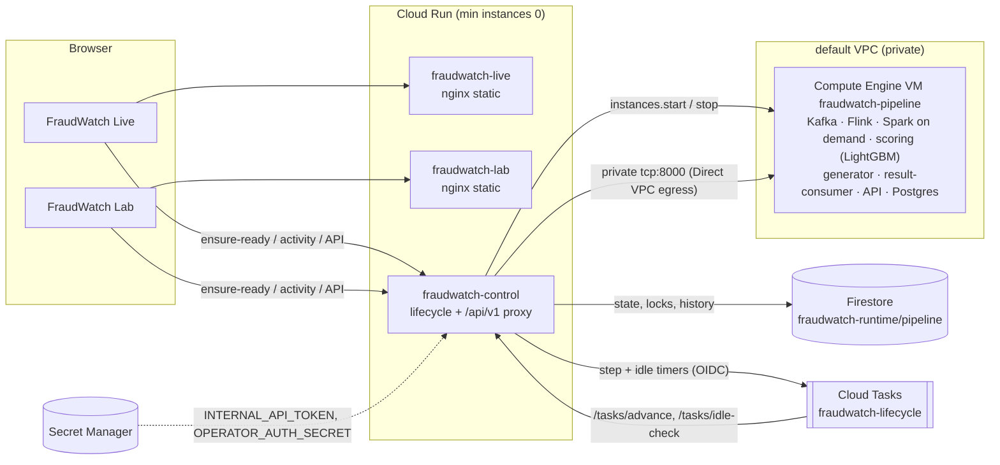
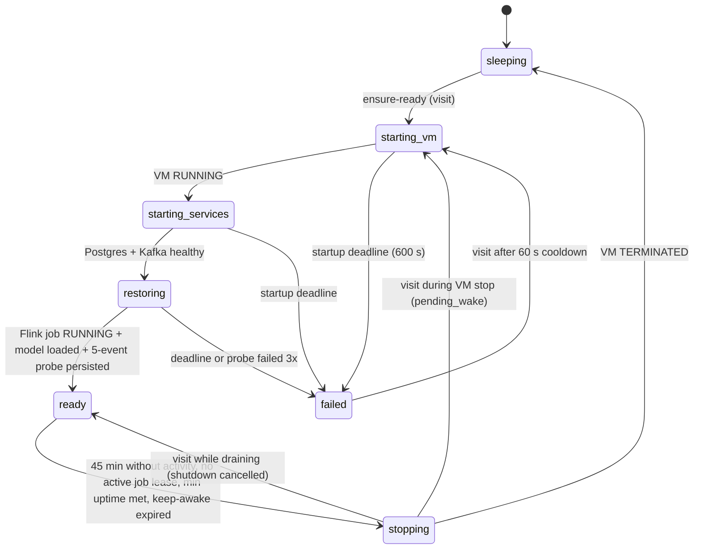

# FraudWatch on Google Cloud: wake-on-visit, idle shutdown

This guide covers deploying FraudWatch to project `fraudwatch-508912` (region `asia-south1`). The project is linked to a **Free Trial** billing account. Every resource below consumes trial credit only. Never upgrade the billing account: the ₹0 out-of-pocket requirement depends on staying on the trial.

## Architecture



- **Websites.** Both are static bundles on Cloud Run. `config.js` is generated at container start and points both sites at the same controller, so they share one backend and one database.
- **Controller** (`services/controller/app.py`). A Cloud Run service with min instances 0. It owns the lifecycle state machine and proxies `/api/v1/*`, including SSE, to the VM's **internal** IP. It returns `503 {"error":{"code":"pipeline_<state>","lifecycle":{…}}}` while the backend is not ready.
- **VM.** The VM has no public ports; firewall `fraudwatch-api-from-cloudrun` allows only `tcp:8000` from the Cloud Run egress subnet (`10.160.0.0/20`). The ephemeral external IP is used for outbound traffic only (image pulls, optional AI APIs).
- **Durable state.** Durable state lives outside the VM. Lifecycle state, the wake lock, activity, per-IP rate limits and history are in Firestore. Timers are Cloud Tasks with OIDC tokens that the controller verifies.
- **Processing state.** Processing state lives on the VM's persistent disk: Kafka log, Postgres, and the retained Flink checkpoints (EXACTLY_ONCE, every 10 s). On boot, the Flink submitter restores from the newest complete checkpoint.

## Lifecycle



| Stage | What is checked | Evidence recorded |
|---|---|---|
| `starting_vm` | Compute `instances.get`; `start` if TERMINATED | GCE operation id |
| `starting_services` | VM `/api/v1/health`: `postgres` and `kafka` are `ok` | `services_up` history event |
| `restoring` | `flink.metrics.job_state == RUNNING`, `scoring` is `ok`, then `POST /internal/probe` (5 replayed events, Flink) until ≥1 scored result is persisted | probe run id, wake duration |
| `ready` | Idle check scheduled for `last_activity + 45 min` | `ready_at` |
| `stopping/draining` | `POST /internal/drain` stops visitor/operator runs | stopped run ids |
| `stopping/waiting_drain` | `/internal/active-work`: in-flight results persisted, or 180 s drain deadline passed; a new experiment aborts shutdown | undrained count |
| `stopping/stopping_vm` | `instances.stop`; the VM shutdown script stops producers, then processors, then Kafka/Postgres | stop duration |

The following count as **meaningful activity**:
- `POST /lifecycle/ensure-ready`
- `POST /lifecycle/activity`, throttled to one write per 30 s per controller instance
- every proxied `POST`/`PATCH` API call

Passive polling (`GET`) does not keep the VM awake.

**Job leases.** A demo run blocks shutdown for at most 30 min after creation; an experiment for 60 min. After that the lease expires, so a stuck job cannot keep the VM running forever.

**Guards.**
- Per-IP wake rate limit: 10 per 10 min.
- Global cap: `PIPELINE_MAX_WAKES_PER_DAY=24` wakes per rolling day.
- Runtime guard: `PIPELINE_MAX_UPTIME_HOURS_PER_DAY=12` h per rolling day.
- A 60 s cooldown applies after a failed start. A failed start also stops the VM.
- Operator keep-awake: `POST /lifecycle/keep-awake {"minutes": ≤180}` with `x-operator-token`. It expires automatically.

**Idempotency.** Every transition is a Firestore transaction guarded by `step_token` or `idle_token`. Duplicate or stale Cloud Tasks deliveries are ignored, and two simultaneous visits start the VM once.

## Configuration

| Variable | Default | Where |
|---|---|---|
| `AUTO_WAKE_ENABLED` | `true` | controller |
| `AUTO_DEMO_ENABLED` / `AUTO_DEMO_MAX_EVENTS` | `true` / `100` | websites (one bounded auto demo per browser session) |
| `PIPELINE_IDLE_TIMEOUT_MINUTES` | `45` | controller |
| `PIPELINE_VM_NAME` / `PIPELINE_VM_ZONE` | `fraudwatch-pipeline` / `asia-south1-a` | controller, scripts |
| `PIPELINE_STARTUP_TIMEOUT_SECONDS` | `600` | controller |
| `PIPELINE_DRAIN_TIMEOUT_SECONDS` | `180` | controller |
| `PIPELINE_MIN_UPTIME_MINUTES` | `10` | controller |
| `CONTROL_STATE_COLLECTION` | `fraudwatch-runtime` | controller |
| `CONTROL_TASK_QUEUE` | `fraudwatch-lifecycle` | controller |
| `INTERNAL_API_TOKEN`, `OPERATOR_AUTH_SECRET` | from Secret Manager | controller; VM `.env` (mode 0600) |

## Deploy (from the repo root, Git Bash)

```bash
infra/gcp/00-verify-billing.sh        # refuses unless linked to the Free Trial billing account
infra/gcp/01-bootstrap.sh             # APIs, Firestore, queue, service accounts, secrets, private firewall
infra/gcp/02-create-vm.sh             # e2-standard-4, 60 GB pd-balanced, Docker installed on first boot
infra/gcp/05-deploy-sites.sh          # builds + deploys fraudwatch-live and fraudwatch-lab
ORIGINS="https://fraudwatch-live-997216389793.asia-south1.run.app,https://fraudwatch-lab-997216389793.asia-south1.run.app"
infra/gcp/03-sync-and-build.sh "$ORIGINS"      # copies backend + model, builds images on the VM, starts the stack
infra/gcp/04-deploy-controller.sh "$ORIGINS"   # lifecycle controller + API proxy
```

After deployment, stop the VM manually or let the idle policy stop it. The first visit wakes it.

**Service accounts (least privilege).**
- `fraudwatch-controller` has:
  - custom role `fraudwatchVmLifecycle` (instances get/start/stop, zone operation get)
  - `datastore.user`
  - `cloudtasks.enqueuer`
  - `serviceAccountUser` on itself, for OIDC task tokens
  - accessor on its two secrets
- `fraudwatch-pipeline-vm` has only `logging.logWriter`.
- The default compute service account was granted `roles/run.builder` so `gcloud run deploy --source` can build.

## Cost model (trial credit, not money charged)

These are **estimates** from list prices for `asia-south1`. Check the GCP pricing pages and **Billing → Reports** for actual consumption. The trial balance was ₹28,662.50 when checked, and it expires 7 Dec 2026.

| Resource | When it consumes credit | Estimate |
|---|---|---|
| VM e2-standard-4 | only while RUNNING | ≈ US$0.16/h |
| Ephemeral external IPv4 | only while RUNNING | ≈ US$0.005/h |
| Persistent disk 60 GB pd-balanced | always, **even while sleeping** | ≈ US$6–7/month |
| Cloud Run (3 services) | per request, scale to zero | within the monthly free tier for a class demo |
| Firestore (default DB) | per read/write | within the free tier (50k reads, 20k writes/day) |
| Cloud Tasks | per operation | within the free tier (1M/month) |
| Cloud Build | per build minute | within the free tier for occasional deploys |
| Artifact Registry | stored images | ≈ US$0.10/GB-month above 0.5 GB |
| Secret Manager | per active version / access | a few cents/month |
| Cloud Logging | ingestion | within the 50 GiB/month free allotment |

A stopped VM does **not** mean zero cost: the disk, stored images and secrets still consume a little credit. The daily wake and uptime guards bound the worst case. For example, 12 h/day of VM time is about US$60/month in credit.

## Operate

```bash
source infra/gcp/env.sh
curl -s https://fraudwatch-control-997216389793.asia-south1.run.app/lifecycle/status      # state + observed VM status
curl -s https://fraudwatch-control-997216389793.asia-south1.run.app/lifecycle/history
G compute instances stop  "$PIPELINE_VM_NAME" --zone "$PIPELINE_VM_ZONE"                   # manual stop
G run services update fraudwatch-control --region "$GCP_REGION" --update-env-vars AUTO_WAKE_ENABLED=false   # disable wake
```

**Shortened idle test.**
1. Redeploy the controller with `PIPELINE_IDLE_TIMEOUT_MINUTES=3 PIPELINE_MIN_UPTIME_MINUTES=1`.
2. Visit, wait for `ready`, stop interacting and confirm `stopping → sleeping` in the history.
3. Revisit and confirm it wakes again.
4. Redeploy with the defaults (45 / 10).

**Rollback.** `G run services update-traffic fraudwatch-control --region "$GCP_REGION" --to-revisions=<previous>=100` (the same works for the sites). For backend code, re-run `03-sync-and-build.sh` from the previous git revision.

## Cleanup (stops all credit consumption)

```bash
source infra/gcp/env.sh
G run services delete fraudwatch-live fraudwatch-lab fraudwatch-control --region "$GCP_REGION"
G compute instances delete "$PIPELINE_VM_NAME" --zone "$PIPELINE_VM_ZONE"          # deletes the disk and all pipeline data
G compute firewall-rules delete fraudwatch-api-from-cloudrun
G tasks queues delete "$CONTROL_TASK_QUEUE" --location "$GCP_REGION"
G secrets delete fraudwatch-internal-api-token; G secrets delete fraudwatch-operator-auth-secret
G artifacts repositories delete cloud-run-source-deploy --location "$GCP_REGION"
```

The Firestore default database can stay; it is within the free tier.

## Security notes

- The VM exposes no public application port.
- `/internal/*` routes require both VPC reachability and `INTERNAL_API_TOKEN`.
- Task endpoints verify a Google-signed OIDC token: audience equal to the controller URL, and the email equal to the controller service account.
- `ensure-ready` and `activity` accept only the two site origins with `X-FraudWatch-Visit: 1`. They are rate-limited per hashed client IP.
- The project's default network still has the stock `default-allow-ssh` (0.0.0.0/0) rule used by `gcloud compute ssh`. To tighten it, restrict it to the IAP range `35.235.240.0/20` and use `--tunnel-through-iap`.
