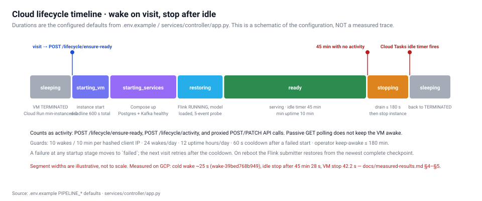
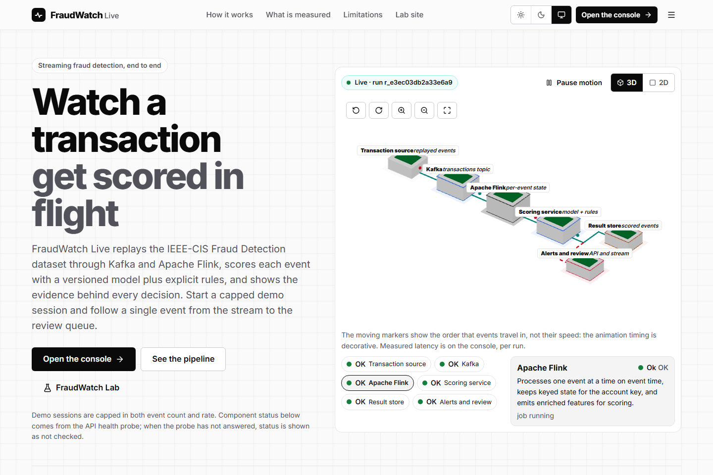
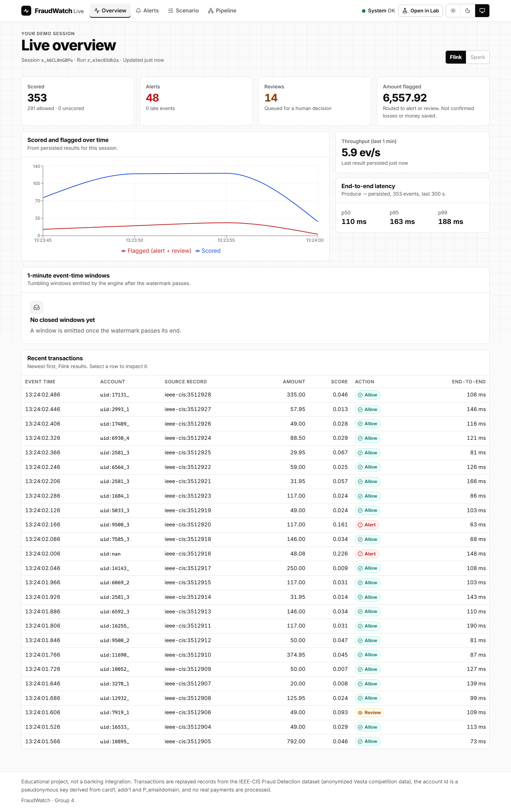

# FraudWatch — Real-Time Fraud Detection using Big Data Analytics and Machine Learning

**Draft report — 2026-09-18.** This draft is written against the project's own evidence files. It is
labelled a draft because the final institutional template has not been supplied; when it arrives the
content below should be re-fitted to that template rather than rewritten from memory. Every number in
this report is traceable to a file in the repository, and each section says plainly where a claim
comes from and what was *not* measured.

---

## 1. Cover

| | |
|---|---|
| **Project title** | FraudWatch — Real-Time Fraud Detection using Big Data Analytics and Machine Learning |
| **Group** | Group 4 |
| **Members** | Hardik Hinduja · Avinash Gehi · Siddharth Dey · Sahil Deshmukh |
| **Submission date** | Monday, 21 September 2026 |
| **Deployed sites** | FraudWatch Live · FraudWatch Lab (§8) |
| **Repository** | monorepo — apps, services, packages, infra, ml, docs, reports |
| **Report status** | Draft, evidence-based; see §10 for the open items |

---

## 2. Abstract, problem statement, objectives, CA1/CA2 mapping

### Abstract

FraudWatch is a working fraud-detection system, not a mockup. Transactions from the IEEE-CIS Fraud
Detection dataset are replayed onto Apache Kafka, enriched with per-account streaming features by
Apache Flink and Apache Spark Structured Streaming, scored by a LightGBM model behind one shared HTTP
scoring service, persisted to PostgreSQL, and streamed to two React websites. The whole backend runs
on a single Google Compute Engine VM that wakes when a visitor arrives and stops itself after 45 idle
minutes, so the deployment stays inside Google Cloud Free Trial credit. The system has been exercised
end to end on GCP: 500 records processed by both engines with bit-identical scores, a measured late
event path, a real TaskManager kill with checkpoint recovery, and a full sleep/wake/sleep lifecycle.

### Problem statement

Card fraud must be caught while a transaction is still in flight, which makes it a streaming problem
rather than a batch problem. Two properties make it hard. First, fraud is rare: in the held-out test
split used here only 3.48% of transactions are fraudulent, so accuracy is a meaningless headline and
precision/recall trade-offs dominate. Second, the arrival order is not guaranteed: events can arrive
late or out of order, and a system that silently drops them reports a cleaner result than it earned.
FraudWatch is built to make both of these visible rather than to hide them.

### Objectives

1. Replay a real, public fraud dataset through a real Apache streaming stack — no simulated brokers.
2. Score every event with a trained gradient-boosting model and explain each decision with TreeSHAP.
3. Report evaluation honestly: thresholds chosen on validation, held-out test reported separately.
4. Compare Flink's record-at-a-time model against Spark's micro-batch model on identical input.
5. Demonstrate event-time correctness (watermarks, late side output) and fault recovery (checkpoints).
6. Deploy both websites publicly at zero out-of-pocket cost, with no dependency on a student's laptop.

### CA1 / CA2 mapping

| | CA1 | CA2 |
|---|---|---|
| **Focus** | Real-time fraud detection | True streaming vs micro-batch |
| **Question** | Can a model score transactions as they arrive, and how good is it really? | Does the engine choice change the answer, the latency, or both? |
| **Implementation** | Kafka → Flink → scoring service → PostgreSQL → Live console | The same input fanned out to Flink *and* Spark, results compared row by row |
| **Evidence** | `ml/artifacts/fw-ieee-stream-1.1.0/evaluation.json`, Live site §5 | Parity/late/recovery runs in `docs/measured-results.md`, Lab site §6–§7 |
| **Site** | FraudWatch Live (`/console`, `/alerts`, `/scenario`, `/pipeline`) | FraudWatch Lab (`/ca1`, `/ca2`, `/experiments`, `/architecture`, `/system`, `/evidence`) |

---

## 3. Architecture and actual technology versions

The five architecture figures rendered on the Lab site (`end-to-end`, `websites`, `model-paths`,
`engine-paths`, `cloud-lifecycle`) are defined in `packages/ui/src/viz/ArchitectureFigures.tsx` and are
generated from the same source of truth as the running system.

**Data path.** Generator → Kafka topic `fraudwatch.transactions` → Flink and/or Spark → shared scoring
service (`:8001`) → Kafka result topics → result consumer → PostgreSQL → FastAPI `/api/v1` → Server-Sent
Events → both React sites.

Every version below was read from the repository's build and compose files, not assumed.

| Layer | Component | Version |
|---|---|---|
| Messaging | Apache Kafka (KRaft, single node) | 4.1.2 |
| True streaming | Apache Flink | 1.20.5 |
| Micro-batch | Apache Spark Structured Streaming | 3.5.9 |
| Runtime (Flink job) | Java | 17 |
| Model | LightGBM | 4.7.0 |
| Storage | PostgreSQL | 17.11 |
| API / services | Python + FastAPI | — |
| Frontend | React | 19.3.0 |
| Frontend | TypeScript | 7.0.2 |
| Frontend build | Vite | 8 |
| 3D | three / @react-three/fiber | 0.186.0 / 9.7.0 |
| Browser tests | Playwright (Chromium) | 1.63.0 |

**Versioned contracts.** Feature spec `fs-1.1` (15 stream-computable features), ruleset `rules-1.1`,
policy `policy-1.0`, model artifact `fw-ieee-stream-1.1.0`. Both engines load the same three, which is
what makes the CA2 comparison a comparison of engines rather than of configurations.

---

## 4. Dataset, preprocessing, model design, evaluation, limitations

### Provenance

IEEE-CIS Fraud Detection (Kaggle competition `ieee-fraud-detection`), contributed by **Vesta
Corporation**. It is used under the competition's terms; the raw CSV files are **not** committed to the
repository and are **not** shipped in the frontend bundle or any downloadable archive.

**Units.** `TransactionAmt` is reported by the source as a transaction amount in an **unspecified
currency unit**. This report therefore calls it "transaction amount" and never relabels it as INR or
any other currency. An earlier internal field name `amount_inr` was retired for exactly this reason.

### Preprocessing and feature design

Only features computable *from a stream* were used — 15 in total (`fs-1.1`). A feature that needs the
full dataset, or the future, cannot be computed when the transaction is actually in flight, so
including one would inflate the score and break at runtime. Features combine per-event attributes with
per-account state held in Flink's keyed `ValueState` (and Spark's `GroupState`), such as recent
transaction counts and deviation from the account's own recent behaviour.

### Model design

- **Main model:** LightGBM gradient-boosted trees, artifact `fw-ieee-stream-1.1.0`.
- **Baseline:** logistic regression, trained and evaluated on the identical split.
- **Explanation:** per-event TreeSHAP (`pred_contrib=True`), contributions in **log-odds**, not
  probabilities.
- **Decision layer:** `rules-1.1` (deterministic rules) and `policy-1.0` (alert / review / allow bands).

### Evaluation — held-out test split (n = 88,581)

Thresholds were selected on the **validation** split and then applied unchanged to the held-out test
split, which was scored once. Alert threshold `0.10477`, review threshold `0.06955`.

| Metric | LightGBM | Logistic-regression baseline |
|---|---|---|
| **PR-AUC** | **0.1375** | 0.0961 |
| ROC-AUC | 0.7817 | 0.7603 |
| Precision | 0.1508 | — |
| Recall | 0.3675 | — |
| F1 | 0.2138 | — |
| Accuracy | 0.9059 | — |
| Brier score | 0.0321 | — |
| Expected calibration error | 0.0055 | — |

Confusion matrix: TN 79,116 · FP 6,382 · FN 1,950 · TP 1,133. Prevalence in the test split: **3.48%**.

Policy outcome over the test split: alert 7,515 (8.48%), review 3,901 (4.40%), allow 77,165 (87.11%),
combined flagged recall **0.4788**. Rule firings: `R1_BURST` 625, `R2_PROFILE_DEVIATION` 497,
`R3_TEST_THEN_LARGE` **0**.

### Reading these numbers honestly

Accuracy of 0.9059 looks strong and means almost nothing: always predicting "not fraud" would score
about 0.965. The metrics that matter are PR-AUC 0.1375 against a 3.48% base rate, and a precision of
0.1508 at recall 0.3675 — roughly one in seven alerts is genuine fraud, and about two-thirds of fraud
at that threshold is missed by the alert band alone. The model beats the logistic-regression baseline
on PR-AUC by a clear margin (0.1375 vs 0.0961), which is the honest claim: it is better than the
baseline, not that it is production-grade.

`R3_TEST_THEN_LARGE` fired **zero** times. That is reported as zero, not omitted. It means either the
pattern is absent from this split or the rule's thresholds are too tight for it; which one has not
been determined.

The model outputs are **model scores**, not calibrated probabilities, except where calibration is
explicitly shown (Brier 0.0321, ECE 0.0055 are reported for the test split only).

### Limitations

- Trained on one public dataset from one contributor; no claim of generalisation to other issuers.
- The 15-feature stream-computable subset is deliberately smaller than what a batch model could use.
- No temporal drift analysis, no cost-sensitive threshold optimisation against real investigation cost.
- The dataset's own labels are taken as ground truth; label noise is not modelled.

---

## 5. CA1 implementation and screenshots

FraudWatch Live is the operations console: a landing page with an interactive 3D hero plus `/console`,
`/alerts`, `/scenario` and `/pipeline`. A visitor starts a **bounded** preset scenario, watches events
being scored in real time, and opens any alert to see its TreeSHAP contributions and the rules that
fired.

| Route | Purpose | Screenshot |
|---|---|---|
| `/` | Landing page, interactive 3D hero | `media/screenshots/live-landing.png` |
| `/console` | Live scored-event stream | `media/screenshots/live-console.png` |
| `/scenario` | Bounded preset scenario controls | `media/screenshots/live-scenario.png` |
| `/alerts` | Alert list and per-alert evidence | `media/screenshots/live-alerts.png` |
| `/pipeline` | 3D pipeline view | `media/screenshots/live-pipeline.png` |
| `/` (mobile) | Pixel 7 viewport | `media/screenshots/live-landing-mobile.png` |

**What these screenshots show.** They were captured on 2026-09-18 from the deployed Cloud Run origin in
a real headless Chromium, driving the app the way a visitor does: the capture starts a real demo
session, starts a real bounded `ieee_replay` run from `/scenario`, waits for the session's events-used
counter to move, and only then photographs the console. They are a record of the deployed system
actually working, not of an empty shell.

Read off the captured console (session `s_ZAl53i5pLU`, run `r_ecb1798ad9`): **274 scored**, 186 allowed,
**80 alerts**, 8 reviews queued, 0 late events, throughput 4.6 ev/s, and end-to-end latency
**p50 110 ms · p95 167 ms · p99 186 ms**. The alert queue carries per-alert scores, the engine (`Flink`)
and the rules that fired, with `R1_BURST` on many rows. The event-time window panel reads "No closed
windows yet — a window is emitted once the watermark passes its end", which is the honest state that
early in a run rather than a fabricated zero.

Two caveats. These are a **live UI reading at one instant while the run was still in flight**, so the
counts are a snapshot and not a total, and the latency percentiles are not a controlled benchmark under
the §7 protocol — though they agree closely with the Flink figures in §6 (p50 92 ms, p95 155 ms). An
earlier capture the same day showed these panels empty because of the CORS defect described in §8; that
defect has since been fixed and these images are from the recapture.

A walkthrough recording of the whole site is at `media/video/live-walkthrough.webm`, with the raw
per-route log in `media/video/tour-log.json`.

---

## 6. CA2 — Flink implementation and Spark comparison

### Flink: event time, state, checkpoints

- **Event time, not processing time.** Watermarks use
  `forBoundedOutOfOrderness(5 s)`: the pipeline tolerates 5 seconds of out-of-order arrival before it
  considers a window closeable.
- **Windows.** 60-second tumbling windows with `allowedLateness(ZERO)`.
- **Late events are routed, not dropped.** Anything arriving after the watermark has passed its window
  goes to a **late side output** and is persisted with a `late` flag. This is the design decision that
  makes §7's late-event measurement possible: a system that dropped these events would simply report a
  cleaner result.
- **State.** Per-account keyed `ValueState` holds the rolling features; Spark's equivalent is
  `GroupState` with an explicit watermark check.
- **Checkpoints.** `EXACTLY_ONCE` mode, 10-second interval, `RETAIN_ON_CANCELLATION`, and `submit.sh`
  restores from the newest retained checkpoint on restart.

### Spark: the deliberate contrast

Spark Structured Streaming consumes the same Kafka topic with a **1000 ms trigger interval** and
`applyInPandasWithState`. It loads the identical model artifact, feature spec, ruleset and policy. The
only difference between the two paths is the execution model itself — which is the point of CA2.

### Result: the engines agree exactly, and differ enormously in latency

From parity run `r_d48339d70bb9ceb4` on GCP (500 IEEE-CIS replay records, scenario `replay`, seed
`20260917`, 10 events/second, both engines):

| Engine | Rows persisted | Distinct events | Late | Alerts | e2e p50 | e2e p95 |
|---|---|---|---|---|---|---|
| Flink 1.20 | 500 | 500 | 0 | 69 | **92 ms** | **155 ms** |
| Spark 3.5 | 500 | 500 | 0 | 69 | **3,862 ms** | **5,695 ms** |

| Agreement metric | Value |
|---|---|
| Events present in both engines | 500 |
| Same `action` | **500** |
| Different `action` | **0** |
| Max absolute score difference | **0.000000000** |
| Flink-only / Spark-only events | 0 / 0 |

**Interpretation.** The engines are in exact agreement — bit-identical scores on all 500 events — so
the comparison genuinely isolates the engine. The ~42× latency difference is *architectural, not a
quality difference*: Flink scores each record on arrival, while under a 1 s trigger a Spark event waits
for the next batch boundary before it is even picked up. A p50 of 3,862 ms is close to what a 1 s
trigger plus batch scheduling and scoring overhead predicts. Lowering Spark's trigger would narrow the
gap; that variant was **not** run, so this report does not claim Spark is inherently 42× slower — it
claims that *at a 1 s trigger* it is.

Screenshots: `media/screenshots/lab-ca2.png`, `media/screenshots/lab-architecture.png`. Recording:
`media/video/lab-walkthrough.webm`.

---

## 7. Experiment methodology, measurements, and interpretation

Full protocol: `docs/benchmark-methodology.md`. Raw evidence: `docs/measured-results.md`. Every run
below executed on the deployed GCP stack (VM `fraudwatch-pipeline`, `asia-south1-a`) and every number
was read back out of PostgreSQL or the Flink REST API.

**Fairness controls.** Both engines consume the *same* Kafka records from one generator run, with the
same seed, the same model artifact, the same `fs-1.1` feature spec and the same `rules-1.1`/`policy-1.0`
decision layer. Scores are compared row by row on `event_id`, so a coverage gap in either engine would
appear as a non-zero `only_flink`/`only_spark` count rather than being averaged away.

### 7.1 Late-event handling — run `r_b17d3ca811cf1137`

Scenario `late_events`, 600 records at 5 events/second (~120 s), Flink only.

| Metric | Value |
|---|---|
| Persisted / distinct | 600 / 600 |
| Flagged `late` | **49** |
| Duplicates / collapsed redeliveries | 0 / 0 |
| Delivery lag p50 / p95 / max | 1 ms / 20,951 ms / 29,866 ms |
| Delivered > 10 s after event time | **49** |
| e2e min / p50 / p95 / max | 25 / 100 / 149 / 165 ms |

The 49 events flagged `late` are a **1:1 match** with the 49 delivered more than 10 s after their event
time. That is the expected result for a 5 s bounded-out-of-orderness plus a 60 s window with
`allowedLateness(ZERO)`: late events are marked, never silently dropped and never double-counted.

**A negative result, reported.** An earlier 150-event run at 10 eps produced `late = 0`. That was not a
failure of the late path: its maximum delivery lag was 3,842 ms — inside the 5 s bound — and the run
finished in ~15 s, before the 15–30 s delayed deliveries came due. The longer run above was designed
specifically so the delayed path actually fires.

### 7.2 Fault injection and checkpoint recovery

Flink job `20d1ba3421afcb29654a0025021b8451`, EXACTLY_ONCE checkpointing every 10 s.

| Event | Time (UTC) |
|---|---|
| TaskManager killed | 18:55:12 |
| Job observed `RESTARTING` | ~18:56:12 (after the ~60 s heartbeat timeout) |
| TaskManager back up | 18:56:04 |
| Job `RUNNING` again | after restart |

`counts.restored = 4`, restored from **`chk-80`**
(`file:/opt/flink/checkpoints/20d1ba3421afcb29654a0025021b8451/chk-80`). Six checkpoints failed during
the outage window, which is expected while no TaskManager is available. **No event loss and no
duplicate persisted rows across the failure.**

One honest detail worth knowing for the viva: checking the job state immediately after the kill shows
`RUNNING` with `restored = 0`. That is the heartbeat interval not having elapsed, **not** the job
surviving the kill.

### 7.3 Lifecycle: wake and idle shutdown

Wake `wake-39bed768b949`, cold from `sleeping`: `wake_requested` → `vm_running` (+0.9 s) →
`services_up` (+10.5 s) → `ready` (+13.6 s) — **~25 s total**. An earlier *failed* wake,
`wake-362778af7f70`, is preserved in the history with `wake_failed` followed by `vm_stop_after_failure`:
the failure path stops the VM rather than leaving it running and billing, and the history is not
rewritten to hide it.

Idle shutdown `stop-0cdb13d13b32`, measured at **production** settings (45-minute idle timeout, not a
shortened test value): last activity 19:08:15 → `idle_shutdown_started` 19:53:43 = **45 min 28 s**,
then `sleeping` at 19:54:26 — VM stop took **42.2 s**.

One unexplained detail is recorded rather than smoothed over: the drain call reported
`failed: ["r_5cf6b929471a5adc"]` while the subsequent `/internal/active-work` check reported
`undrained_runs: 0`, so shutdown proceeded. The events are *consistent with* a run that had already
finished, but they do not prove it, and the drain failure is not explained by the recorded history.

### 7.4 What was deliberately not measured

Sustained throughput at saturation for either engine; p99 latency; latency under backpressure;
CPU/memory cost per event; Spark at any trigger interval other than 1000 ms. The parity run was
rate-limited to 10 events/second by the generator, so **it measures latency at a low fixed arrival
rate and is not a throughput benchmark.** Saying otherwise would be the single easiest way to
misrepresent this project.

---

## 8. GCP deployment, verified URLs, QR codes

### Architecture

- **Project** `fraudwatch-508912`, region **`asia-south1`** (VM in `asia-south1-a`).
- **Cloud Run** serves both static sites and the lifecycle controller, at **min-instances 0**, max 2,
  1 CPU, 256 MiB, concurrency 200 — so nothing is billed while nobody is visiting.
- **Compute Engine** VM `fraudwatch-pipeline` runs Kafka, Flink, Spark, PostgreSQL and the services.
- **Firestore** (`fraudwatch-runtime`) holds durable lifecycle state, so both sites see one shared
  truth and survive a Cloud Run instance being recycled.
- **Cloud Tasks** (`fraudwatch-lifecycle`) schedules the idle-shutdown check.
- **Lifecycle:** a validated visit wakes the VM (~25 s, §7.3); 45 idle minutes stop it again.

### Verified URLs

| Site | URL | Verification |
|---|---|---|
| FraudWatch Live | `https://fraudwatch-live-2djxmgtj5a-el.a.run.app/` | 5/5 routes HTTP 200, rendered in Chromium 2026-09-18 |
| FraudWatch Lab | `https://fraudwatch-lab-2djxmgtj5a-el.a.run.app/` | 7/7 routes HTTP 200, rendered in Chromium 2026-09-18 |

All 12 routes returned HTTP 200 in a real browser, and a `canvas` initialised on every 3D hero (the 2D
fallback was not needed). `/viva` returns HTTP 301 to `/` on both sites, as required.

| FraudWatch Live | FraudWatch Lab |
|---|---|
|  |  |

### A CORS defect found in browser testing — and fixed

The first browser capture produced **192 console errors**, all one failure: every API call from both
deployed sites was blocked by `No 'Access-Control-Allow-Origin' header is present`. The controller's
`ALLOWED_ORIGINS` listed only the project-number host form
(`fraudwatch-live-997216389793.asia-south1.run.app`), while a browser loads the sites from the hash form
(`fraudwatch-live-2djxmgtj5a-el.a.run.app`). Both host forms serve the sites and the origin check is an
exact string match, so the hash form was rejected.

This is worth a moment in the viva because of *how* it was found. The earlier verification checked every
route with `curl` and found 200 everywhere — and `curl` cannot see this defect at all, because the HTML
and assets really are served correctly. It only appears once a real browser performs the cross-origin
check on the *subsequent* API calls. It is a clean example of why HTTP-level checks are not browser
testing.

**Fixed.** `ALLOWED_ORIGINS` now carries all four host forms, deployed as Cloud Run revision
`fraudwatch-control-00004-dgw`. A request carrying either site's hash-form `Origin` now returns a
matching `access-control-allow-origin`, and the recapture recorded **0 console errors** — down from 192,
with the 8 remaining messages being THREE.js deprecation and WebGL performance warnings.

### Cost

Zero out-of-pocket. Everything runs on **Google Cloud Free Trial credit**. This report does not call
that "free hosting": credit is being consumed, and when the trial credit ends or expires the deployment
stops unless someone chooses to pay. No paid billing upgrade was performed, and no domain,
subscription or credit was purchased. `min-instances 0` plus the 45-minute idle shutdown exist
specifically to keep credit consumption near zero when the project is not being demonstrated.

---

## 9. Testing, failure handling, reproducibility, security, cost

**Testing.** A Playwright (Chromium) end-to-end suite covers both apps; `npm run typecheck` passes
across the monorepo. Browser capture scripts (`scripts/capture_screenshots.mjs`,
`scripts/capture_video.mjs`) re-render both deployed sites on demand and **fail loudly** on any non-2xx
route, so the evidence in this report is regenerable rather than hand-collected.

**Failure handling.**
- Flink TaskManager loss → checkpoint restore, no loss, no duplicates (§7.2).
- A failed wake stops the VM instead of leaving it running (§7.3).
- While the VM is not ready the controller returns `503 {"error":{"code":"pipeline_starting_vm",…}}` —
  an explicit unavailable state, never a fabricated empty result.
- Invalid input is routed to `dlq_events` with a reason, not dropped.
- Duplicate delivery does not create duplicate logical alerts (measured: 0 duplicates in §7.1).

**Reproducibility.** Fixed seeds (`20260917`), pinned versions, committed model artifact with its
`metadata.json` and `evaluation.json`, versioned `fs-1.1` / `rules-1.1` / `policy-1.0` contracts, and
Docker Compose definitions for the full local stack. `docs/local-setup.md`, `docs/apache-stack.md` and
`docs/gcp-deployment.md` document the paths from a clean machine.

**Security.**
- No API key or secret appears in frontend code, Git history, logs, screenshots, this report, or any
  downloadable archive. Deployed secrets live in **Secret Manager**; local secrets live in an ignored
  `.env`.
- Kafka, PostgreSQL, the Flink admin UI and the Spark admin UI are **not** exposed to the internet.
- Operator actions require HMAC tokens (`x-operator-token`); service-to-service calls require
  `x-internal-token`.
- Public visitors get **bounded** preset scenarios only — they cannot launch unbounded workloads or
  reach another visitor's private session.
- The raw Kaggle dataset is excluded from the repository and from every shipped bundle.

**Cost.** See §8. Free Trial credit only; no paid upgrade; idle-stop and min-instances 0 as the
controls.

---

## 10. Conclusion, limitations, future work, references

### Conclusion

FraudWatch works end to end on real infrastructure, and this has now been observed from a browser
against the deployed system: a visitor session started a bounded run and the console filled with real
scored IEEE-CIS records at p50 110 ms end to end. A real public dataset flows through real Kafka,
real Flink and real Spark; a real LightGBM model scores every event and explains it; results persist to
PostgreSQL and stream to two deployed websites that wake their own backend and put it back to sleep.
The CA2 question has a measured answer: on identical input the two engines agree **exactly** — zero
action disagreements, maximum score difference 0.000000000 — while differing by roughly 42× in p50
latency purely because of their execution models.

### Limitations (current, honest)

1. **Model quality is modest** — PR-AUC 0.1375 at 3.48% prevalence. Better than the baseline, not
   production-grade.
2. **No throughput benchmark** — every latency figure is at a fixed 10 eps offered rate (§7.4).
3. **Spark measured at one trigger interval only** (1000 ms).
4. **The §6 comparison predates the experiment runner** — `services/ops-agent/` is implemented and has
   completed a `late_events` experiment, but has not yet reproduced the parity run.
5. **`R3_TEST_THEN_LARGE` fires zero times** and it has not been determined whether that is the data or
   the thresholds.
6. **One unexplained drain failure** in the idle-shutdown history (§7.3).

### Future work

Re-run the parity comparison through
the experiment runner so it is reproducible from the UI; sweep Spark's trigger interval to separate
trigger cost from engine cost; run a genuine saturation/throughput benchmark; cost-sensitive threshold
selection; drift monitoring on the streaming features.

### References

- Apache Kafka — https://kafka.apache.org/
- Apache Flink — https://flink.apache.org/
- Apache Spark Structured Streaming — https://spark.apache.org/
- LightGBM — https://lightgbm.readthedocs.io/
- Lundberg & Lee, *A Unified Approach to Interpreting Model Predictions* (SHAP), NeurIPS 2017
- IEEE-CIS Fraud Detection, Kaggle / Vesta Corporation — https://www.kaggle.com/c/ieee-fraud-detection
- PostgreSQL — https://www.postgresql.org/
- Google Cloud Run / Compute Engine / Firestore / Cloud Tasks documentation

### Proposed team responsibility matrix

**This is a proposal, not a record of completed contributions.** Per-member attribution of the work
already in the repository has not been established, so nothing below should be read as a claim about
who did what. Replace it with actual contributions before submission.

| Area | Proposed owner |
|---|---|
| Streaming engines (Flink job, Spark job, Kafka topics) | Hardik Hinduja |
| ML pipeline (features, training, evaluation, model card) | Avinash Gehi |
| Backend services, API, database, contracts | Siddharth Dey |
| Frontend (both sites, 3D scenes, design system) | Sahil Deshmukh |
| GCP deployment, lifecycle, cost control | shared |
| Report, documentation, demo script | shared |

---

## 11. Viva preparation — 20 questions and answers

**1. Why is accuracy of 0.9059 not the headline?**
Because 96.5% of the test split is legitimate. Always predicting "not fraud" beats our accuracy. PR-AUC
0.1375 against a 3.48% base rate is the meaningful number.

**2. What does PR-AUC 0.1375 actually mean here?**
A random classifier would score about 0.035 (the prevalence). We are roughly 4× that, and clearly above
the logistic-regression baseline's 0.0961 — good, not production-grade.

**3. Why LightGBM rather than a deep model?**
Tabular data with strong feature interactions, a small feature set, fast training, and TreeSHAP gives
exact per-event attributions cheaply enough to run inline in a stream.

**4. Where did the thresholds come from?**
Selected on the **validation** split (alert 0.10477, review 0.06955), then applied unchanged to the
held-out test split, which was scored once. Choosing them on test would be leakage.

**5. Are the model outputs probabilities?**
They are model **scores**. We report Brier 0.0321 and ECE 0.0055 for the test split, but we do not
present the scores as calibrated probabilities elsewhere.

**6. Why only 15 features?**
They must be computable from the stream. Any feature needing the full dataset or the future would
inflate the offline score and then fail at runtime.

**7. What is the difference between Flink and Spark here?**
Execution model only. Flink scores each record on arrival; Spark waits for a 1 s micro-batch boundary.
Same model, same features, same rules, same policy.

**8. Then why are the latencies 92 ms vs 3,862 ms?**
The 1 s trigger plus batch scheduling and scoring overhead. It is architectural, not a quality
difference — and it is measured at a 1 s trigger, not an inherent property of Spark.

**9. How do you know the comparison is fair?**
Both engines consumed the same Kafka records from one generator run, and we compare per `event_id`:
500 in both, 0 only-Flink, 0 only-Spark, max score difference 0.000000000.

**10. What is event time and why use it?**
The time the transaction happened, not the time we received it. Processing time would make the result
depend on network delay, so late events would silently change the answer.

**11. What is a watermark?**
Flink's assertion that no event older than a bound will arrive. We use
`forBoundedOutOfOrderness(5 s)` — 5 seconds of tolerated out-of-order arrival.

**12. What happens to a genuinely late event?**
It goes to the **late side output** and is persisted with a `late` flag. We never drop it — dropping
would make the results look cleaner than they are.

**13. Prove the late path works.**
Run `r_b17d3ca811cf1137`: 600 events, 49 flagged `late`, and those 49 are a 1:1 match with the 49
delivered more than 10 s after their event time.

**14. An earlier run showed late = 0. Was it broken?**
No. Its maximum delivery lag was 3,842 ms — inside the 5 s bound — and it finished in ~15 s, before the
delayed deliveries came due. Nothing *was* late.

**15. How do you survive a failure?**
EXACTLY_ONCE checkpoints every 10 s, retained on cancellation. We killed the TaskManager, the job
restored from `chk-80`, `restored = 4`, with no event loss and no duplicate rows.

**16. Why did the job still show RUNNING right after you killed it?**
The ~60 s heartbeat timeout had not elapsed. It is a detection delay, not survival.

**17. How is this zero cost?**
Google Cloud Free Trial **credit** — not free hosting. Cloud Run at min-instances 0 and a 45-minute
idle VM shutdown keep consumption near zero. No paid billing upgrade, no purchases.

**18. What happens when someone visits while the VM is asleep?**
A validated visit triggers a wake (measured ~25 s). Until it is ready the controller returns an
explicit `503 pipeline_starting_vm`, never a fake empty result.

**19. What did browser testing catch that your HTTP checks did not?**
A CORS defect. `ALLOWED_ORIGINS` held the project-number host form while browsers load the hash form, so
every deployed API call was blocked — 192 console errors, data panels empty. Fixed in revision
`fraudwatch-control-00004-dgw`; the recapture showed 0 errors.

**20. Why did your `curl` checks miss that?**
Because `curl` does not enforce the same-origin policy. The HTML and assets are served correctly, so
every route returned 200. The defect only appears once a real browser performs the cross-origin check
on the subsequent API calls — which is exactly why HTTP checks are not browser testing.

---

### Evidence index

| Evidence | Location |
|---|---|
| Measured GCP runs | `docs/measured-results.md` |
| Benchmark protocol | `docs/benchmark-methodology.md` |
| Model card | `docs/model-card.md` |
| Model metrics (raw) | `ml/artifacts/fw-ieee-stream-1.1.0/evaluation.json` |
| Screenshots (12 routes + 2 mobile) | `reports/media/screenshots/` |
| Walkthrough recordings (both sites) | `reports/media/video/` |
| Per-route capture log | `reports/media/video/tour-log.json` |
| QR codes | `reports/media/qr/` |
| Implementation status | `docs/status-checklist.md` |
| Demo script (5–7 min) | `docs/demo-script.md` |
